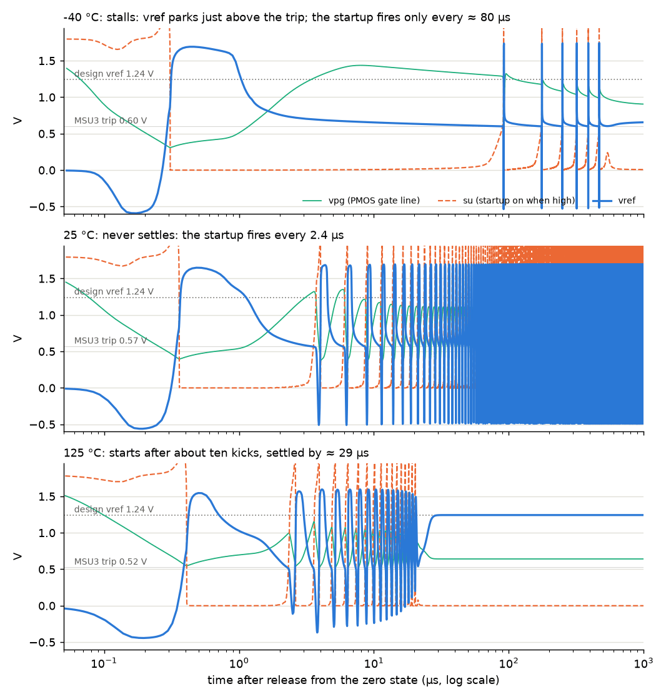
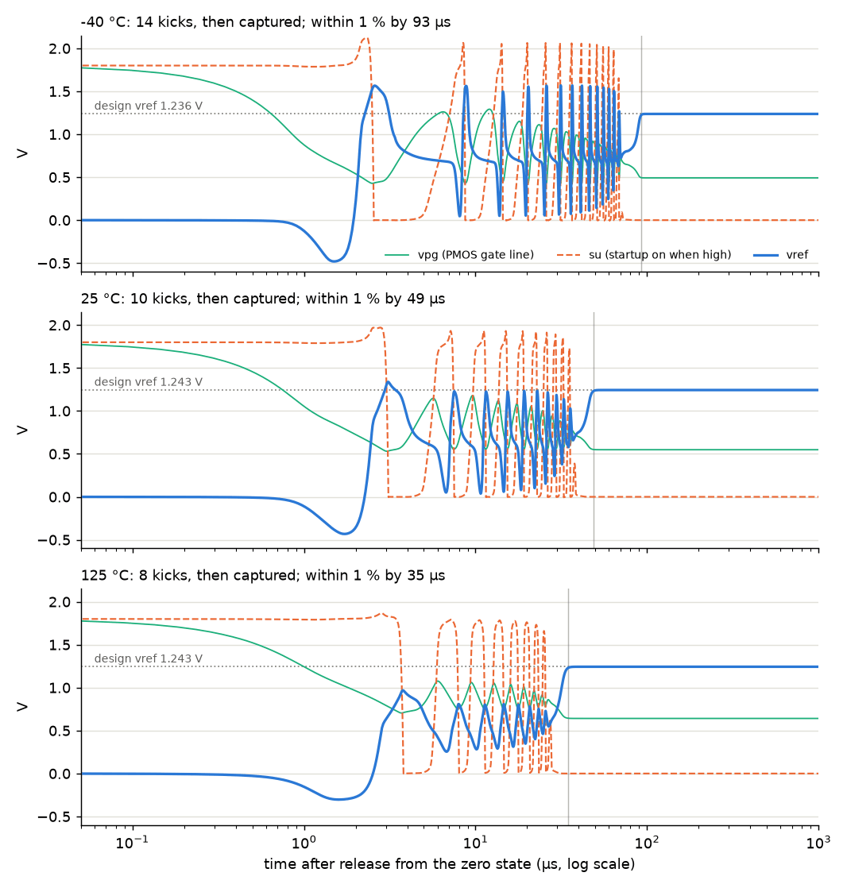

# M5 results — bandgap core `bgr`

*M5 simulation CLOSED; `bgr` FROZEN (19 pins; record in `freeze_m5.txt`). Everything below ran at tt and over 15 corners × 1.62–1.98 V × −40…125 °C. Every guaranteed spec row passes, with four documented exceptions: (1) core C/V at hot `_ll`/fs corners, worst 1.18 °C/V (8b); (2) χ_nom spread 0.023 at −20 °C (8c); (3) the chop-average check reworded, because the log-law even term ∝ Vos² is checked at the 3σ Vos after the trim (9a); (4) MC core residual 0.72 / 0.50 K chopped against 0.34 / 0.25 K, from the PNPs' temperature-dependent mismatch (10). Key numbers: μ_DC 0.4292 at 25 °C, dμ/dT 1.443e-3/K; f_u 230 kHz, PM 87.9°; startup ≤ 53.5 µs; chop sign μ_A < μ_B for +10 mV on MP1. Predicted sensor total ±1.28 / ±0.92 °C at 100 / −20 °C, inside ±2.0 °C. Layout: every cell and the `bgr` top level are LVS-clean against the frozen netlist (sections 12–18). `bgr` is in the tile (section 18; local precheck passes). Next: PEX.*

*Cells, benches and runners in `tt_tsense/xschem` next to `ota2s`; run folders in `xschem/simulation/` (`pvt8/`, `chop9/`, `mc10/`, ...).*

## 0. The heart by hand (tt, 25 °C)

R1 = 4 × 4.884 = 19.536 kΩ; I = 54.1143 mV / R1 = 2.770 µA (sim 2.7726, Ru quoted at 27 °C); V_REF = 0.709973 + 10 × 0.0541143 = 1.2511 V; Z_A = V_T/I = 9.27 kΩ; β = gm_P·R1 = 24.1 µS × 19.536 kΩ = 0.471; the op-amp offset −29.2 µV moves I by −1.49 nA (−0.054 %) and V_REF by K·Vos = −0.29 mV. Loop sign: +1 mV on vpg drops every PMOS current by 24.1 nA, va falls 0.223 mV, vb (the "+" input) falls 0.694 mV, so v+ − v− = −0.471 mV and the op-amp drives vpg back down: negative feedback with "+" on the R1 side.

## 1. `bg_pnp`, `bg_rrow`, smoke test `tb_bg_cells`

`bg_pnp`: Q1 m=1, Q2 m=8, Q3 m=1, QD m=15 (25 PNPs). `bg_rrow`: R1 = 4 wired units, R3 = `R3[39:0]` (40 units by bus notation), RD = 4 dummies, all `res_high_po_1p41` L=20 (48 in the netlist). Bench = the two cells + the ideal op-amp and mirrors from M3 `k_extract.cir`.

| T (°C) | I (µA) | V_EB3 (V) | ΔV_EB (mV) | V_REF, 40 units (V) | V_REF − formula |
|---|---|---|---|---|---|
| −20 | 2.39783 | 0.787133 | 45.8982 | 1.24612 | −2 pV |
| 25 | 2.77263 | 0.709973 | 54.1143 | 1.25112 | +0.3 pV |
| 100 | 3.33579 | 0.574972 | 67.8785 | 1.25376 | −2 pV |

Identical to M3 T6. V_REF across the real R3 equals V_EB3 + 10·ΔV_EB to solver noise: the same current flows through identical units, so the ratio holds at every corner; only mismatch (H4: σ(R3/R1) 0.245 %) and layout parasitics break it. Two typos found on the first run: `lab=lab=…` on the R3 M pin (named the net `lab`, shorting the chain) and a lost `*` on the code block's comment line.

## 2. `bg_mirror` and loop polarity (`tb_bg_pol`)

`bg_mirror` (Rev E): eight `pfet_01v8` W=8.8 L=20 on one `vpg` line, sources on VDPWR: P1 ×4, P2 ×4, P3a ×2, P3b ×2 (drains `d3a`/`d3b`), P4a ×1, P4b ×1, P7 ×2, P5 ×2 = 18 fingers. Hand (tt, 25 °C): 18 × I/4 = 12.48 µA from VDPWR; gate-line load 18 × 0.89 pF = 16.0 pF, inside `ota2s`'s 15–25 pF window. The symbol's pin order follows the order the iopins were placed (cosmetic; subckt and instance always agree).

**2b, `op`:** section 1 cells + `bg_mirror` + a behavioral op-amp (gain 1e6, GBW 100 kHz, clamped at 1.8 V); 0 V ammeters on d1, d2, d3a, d3b; P4a, P4b, P7 and P5 drains parked at 0.71 V.

| T (°C) | I1 = I2 (µA) | I3a = I3b (µA) | ε3 = I3/I1 − 1 | V_SG (V) | V_REF (V) | V_REF − section 1 (mV) | I_total (µA) |
|---|---|---|---|---|---|---|---|
| −20 | 2.39782 | 1.18346 | −1.289 % | 1.29102 | 1.23991 | −6.21 | 10.767 |
| 25 | 2.77263 | 1.36812 | −1.313 % | 1.25151 | 1.24367 | −7.45 | 12.4404 |
| 100 | 3.33580 | 1.64521 | −1.360 % | 1.18260 | 1.24408 | −9.68 | 14.9525 |

- **Equilibrium = section 1:** I1 matches the ideal-mirror bench to 6 digits and va − vb ≤ 1 µV. V_SG = 1.2515 V at 25 °C, as the spec has it.
- **ε3 is channel-length modulation, nothing else:** P3's V_SD = 1.8 − vref ≈ 0.556 V against P1/P2's 1.8 − va = 1.01–1.23 V. One P1-size finger swept alone at the bench's V_SG gives the same ε3 (−1.2889 / −1.3127 / −1.3604 %).
- **V_REF shift = ε3·I·R3 + n·V_T·ln(1 + ε3)** (n = 1.034): −20 °C −5.92 − 0.29 = −6.21 mV; 25 °C −7.10 − 0.35 = −7.45 mV; 100 °C −9.23 − 0.46 = −9.69 mV. The first term is R3 carrying 1.3 % less current; the second is Q3 at 1.3 % less current.
- **ε3 barely moves with T** (0.07 points over 120 K), so it acts like a smaller K: K_eff = 10 × (1 + ε3) ≈ 9.87, closer to M3's K_opt 9.652. The V_REF span over −20…100 °C falls from 7.64 mV (section 1) to 4.17 mV.
- **N3 rule (V_REF(tt) ≥ 1.245 V over −20…100 °C) fails at all three temperatures** with the real mirror, and −20 °C sits below the 1.24 V floor even in tt. Input to section 5 (N3 = 41 vs the B14 floor note); there, V_REF(N3) = V_EB3 + (1 + ε3)(N3/4)·ΔV_EB.
- **I_total = 18 × I/4 − 0.036 µA:** every other copy equals its ratio to 6 digits (drains parked at P1's voltage); the 0.036 µA is P3's 1.3 % of 2.77 µA.
- **P3a = P3b exactly:** both drains sit on `vref`.
- **λ of one W=8.8 L=20 finger, backed out of 2b:** λ = (1 − r)/(r·V_SD1 − V_SD3), r = I3/I1, V_SD1 = 1.8 − va, V_SD3 = 1.8 − vref. Result: 0.0293 / 0.0253 / 0.0209 V⁻¹ at −20 / 25 / 100 °C (V_A = 34.1 / 39.6 / 48.0 V). The fall is temperature, not the V_SD span: one finger on a fixed 0.556 → 1.09 V span gives the same values, and at fixed T the incremental λ changes only ≈ 11 % from V_SD 0.55 to 1.3 V. ε3 stays flat because ΔV_SD = V_SD1 − V_SD3 grows (0.45 → 0.53 → 0.67 V) while λ falls.
- **Preview for M6 (P4 is the same device):** ε_λ = V_REF/V_A = 3.6 / 3.1 / 2.6 %, so the period model's δμ = (1 − μ)μ·ε_λ/2 = 4.23e-3 / 3.86e-3 / 3.22e-3 changes by ≈ 1.0e-3 from −20 to 100 °C, against the 1.5e-4 δμ_ramp row (≈ 0.7 K against 0.1 K). M6's `tb_p4_lambda` measures ε_λ(T) on P4's own ramp (V_SD 0.55 → 1.8 V) and owns the decision.

**2c, loop polarity (tt, 25 °C):** the same bench, op-amp inputs normal (`pol=1`) then swapped (`pol=-1`). `Vkick` sits between `oa` and `vpg`: it breaks the loop for AC (T = −v(oa)/v(vpg)) and adds a 1 mV, 1 µs kick in the transient.

| | pol = +1 (normal) | pol = −1 (swapped) |
|---|---|---|
| `op`: I1 (µA) / vpg (V) | 2.77263 / 0.548486 | 2.77267 / 0.548484 |
| \|T\| at 1 mHz | 113.4 dB | 113.4 dB |
| ∠T at 1 mHz | −0.57° | +179.4° |
| f_u | 46.99 kHz | 46.99 kHz |
| vpg 10 µs / 100 µs after the kick | 0.548463 / 0.548487 V | 0.551773 / 1.8 V |
| I1 at 100 µs | 2.77288 µA | 0.0006 µA |

- **`op` cannot see the loop sign:** the swapped loop balances at the same point (I1 within 0.04 nA).
- **|T| = 120 dB + 20·log(0.471) = 113.5 dB and f_u = 100 kHz × 0.471 = 47.1 kHz:** section 0's β = gm_P·R1 = 0.471.
- **Swapped, the kick grows** (3.3 mV off by 10 µs, from a 1 mV push) and vpg runs to the 1.8 V rail: every PMOS off, the zero-current state.
- **Section 2 done-when, all met:** equilibrium = section 1; the swapped kick fails; V_SG ≈ 1.25 V; P3a = P3b, sum = the single-P3 value.
- **Link to Rev E:** in half-current mode P3a's drain moves from 1.25 V to ≈ 0.96 V (V_SD 0.55 → 0.84 V), so with this λ, ρ = I_P3a′/I_P3 = 0.5·(1 + λ·0.836)/(1 + λ·0.556) = 0.5035 at 25 °C, the CLM value behind χ_nom ≈ +0.09 (χ ≈ 12.2·(2ρ − 1)).

## 3. `bg_core`, `bgr`, first real OP

**3a, `bg_core` with the stand-in op-amp (`tb_bg_core`):** `bg_core` = `bg_pnp` + `bg_rrow` + `bg_mirror` + MNB1–MNB4 (nfet_01v8 W=4 L=8, MNB3/MNB4 `mult=4`), 14 pins. Bench: section 2's behavioral op-amp on `vpg`; P3b → `vref` through a 0 V ammeter; P4a, P4b and P7 parked on a 1× copy of `va` (E-source), so they see P1's own V_SD; MNB2–MNB4 drains parked at 0.70 V (the `ota2s` IBIAS diode level).

| T (°C) | V_REF (V) | vpg (V) | I_PTAT = 2(I4a + I4b) (µA) | I3b (µA) | I_B (µA) | I_B/I_PTAT | I_cmp (µA) | nb (V) |
|---|---|---|---|---|---|---|---|---|
| −20 | 1.23991 | 0.508976 | 2.39782 | 1.18346 | 1.20253 | 0.50151 | 4.81012 | 0.691023 |
| 25 | 1.24367 | 0.548487 | 2.77263 | 1.36812 | 1.38812 | 0.500652 | 5.5525 | 0.680912 |
| 100 | 1.24408 | 0.617401 | 3.3358 | 1.64521 | 1.66617 | 0.499483 | 6.66469 | 0.668622 |

- **Equals section 2b to every printed digit** (V_REF, vpg, va, I1, I3b). Grouping the cells into `bg_core` changed nothing, and moving the copies' park from 0.71 V to `va` does not touch the loop: the copies are outputs.
- **I7 = I_PTAT/2 and I_cmp = 4·I_B exactly:** same gate, same drain voltage, same current per finger.
- **I_B/I_PTAT − 0.5 is channel-length modulation in two places:** P5 against P1 (V_SD = 1.8 − nb against 1.8 − va, λ_p from section 2), and MNB2 against MNB1 (V_DS = 0.70 V against nb).

| T (°C) | P5 − P1 ΔV_SD (mV) | P5 term | MNB2 − MNB1 ΔV_DS (mV) | MNB term | sum | sim |
|---|---|---|---|---|---|---|
| −20 | +96 | +0.27 % | +9 | +0.03 % | +0.30 % | +0.30 % |
| 25 | +29 | +0.07 % | +19 | +0.06 % | +0.13 % | +0.13 % |
| 100 | −94 | −0.19 % | +31 | +0.09 % | −0.10 % | −0.10 % |

- **λ of nfet_01v8 W=4 L=8, backed out of the MNB term:** 0.032 / 0.031 / 0.028 V⁻¹ at −20 / 25 / 100 °C.
- **The sign flips at 100 °C** because `va` (0.575 V) falls below `nb` (0.669 V), so P1 now sits at the larger V_SD.
- **The copy error is +0.13 % at 25 °C.** Rule: copy error ≈ λ·ΔV_SD. A 1 % error needs ≈ 0.4 V of drain difference (P3 in 2b: 0.53 V → −1.3 %); here it is 29 mV.
- **The 0.45–0.55 row is for mismatch** (σ(I_B) ≈ 2.5 %, hand); the systematic part is ≤ 0.3 %.
- **First netlist failed on two stacked duplicates:** a second `vref` iopin on top of the first in `bg_core.sch` (the symbol came out with 15 pins) and a second `vpg` label in the bench. xschem reports "overlapped instance", exits with code 10 and stops a `&&` chain; its "open net" warnings were side effects and cleared with the fix.

**3b, `bgr` = `bg_core` + the real `ota2s` + four input chop switches, state A (`tb_bg_op`):** instances `xcore`, `xota`, S1–S4 (nfet_01v8_lvt W=4 L=0.5, body VGND). State A: `swa` = 1.8 V puts S1 (va → inn) and S2 (vb → inp) on; `swb` = 0; CHOP = 0, CHOPB = 1.8 V. The op-amp's IBIAS diode is now MNB2's load. Same parks as 3a.

| T (°C) | V_REF (V) | ΔV_REF vs 3a (mV) | vpg (V) | I_PTAT (µA) | ΔI_PTAT (nA) | Vos = vb − va (µV) | M3 servo Vos (µV) | I_B (µA) | I_B/I_PTAT | v(ibias) (V) | tail margin (V) |
|---|---|---|---|---|---|---|---|---|---|---|---|
| −20 | 1.23931 | −0.60 | 0.509102 | 2.39474 | −3.08 | −59.26 | −58.25 | 1.1979 | 0.500222 | 0.634 | 0.362 |
| 25 | 1.24336 | −0.31 | 0.54855 | 2.77111 | −1.52 | −30.05 | −29.21 | 1.38725 | 0.500613 | 0.697 | 0.483 |
| 100 | 1.24424 | +0.16 | 0.617366 | 3.33661 | +0.81 | +15.58 | +16.27 | 1.67087 | 0.500768 | 0.805 | 0.686 |

- **Vos is within 1 µV of the M3 servo at all three temperatures.** The op-amp sees the same input common mode and nearly the same bias as in M3.
- **ΔI_PTAT = Vos/R1:** −3.03 / −1.54 / +0.80 nA by hand (R1 = 19.536 kΩ).
- **ΔV_REF = (K_eff + 1/ln N)·Vos ≈ 10.35·Vos:** −0.61 / −0.31 / +0.16 mV by hand. Two parts:
  - **K_eff·Vos** (9.87·Vos) is the PTAT drop across the output resistor.
  - **Vos/ln N** (≈ 0.48·Vos) is V_EB3 following the smaller current: n·V_T·ΔI/I = n·V_T·Vos/(I·R1) = Vos/ln N, because I·R1 = n·V_T·ln N. At −20 °C, veb3 moved −29 µV against −28.5 µV by hand.
- **Hand check, K_eff·Vos with the M3 offsets: −0.572 / −0.286 / +0.158 mV**, the right sign and ≈ 95 % of the size at every temperature. The missing 5 % is the V_EB3 term.
- **I_B/I_PTAT moved −0.26 % / −0.01 % / +0.26 % from 3a.** MNB2's drain is now the IBIAS diode, 1.8 V − V_SG(XMREF) = 0.634 / 0.697 / 0.805 V, not a fixed 0.70 V. So its V_DS changes by −66 / −3 / +105 mV. Hand: λ_n·ΔV_DS = −0.21 % / −0.01 % / +0.29 %.
- **The tail margin is smallest at −20 °C (0.36 V)** because the input common mode (va ≈ 0.787 V) is highest when V_EB is largest.
- **The on-switches drop only nanovolts:** inp − vb = inn − va = −1.8 / −1.5 / −15.5 nV. This is leakage into the op-amp input nodes times R_on, and it grows ~10× at 100 °C. The two sides agree to < 1 pV, so the leakage is common mode and cancels in Vos.
- **First netlist failed:** S2–S4 sat 0.46 grid units off their wires (x = 339.54 / 349.54), S2's gate was on `swb`, and the `va`/`vb` nets had no labels, so the bench's `x1.va` would not have resolved. xschem reports "undriven node", exits non-zero and stops the `&&` chain.

**3c, chop state B (`tb_bg_op_b`):** `swa` = 0, `swb` = 1.8 V (S3 va → inp, S4 vb → inn), CHOP = 1.8 V, CHOPB = 0. Same parks.

- **State B equals state A to every printed digit at all three temperatures** (V_REF, vpg, I_PTAT, Vos −59.26 / −30.05 / +15.58 µV, I_B/I_PTAT, tail margin). With no mismatch, state B is the mirror image of state A: same devices, left and right relabelled. So the solution is the same.
- **The −30 µV does not flip:** it is `ota2s`'s systematic offset. It belongs to the op-amp's effective +/− inputs, and the input swap plus the CHOP swap keep `va` on the effective −. The chop cancels only offsets tied to physical devices (MP1/MP2, load mismatch), which flip sign between the states (section 9's forced-mismatch test). Here there is none to cancel.
- **Wrong-sign loop (inputs swapped, CHOP left in state A), 25 °C: the OP still converges.**

| run | V_REF (V) | vpg (V) | I_PTAT (µA) | Vos = vb − va (µV) |
|---|---|---|---|---|
| state A or B | 1.24336 | 0.54855 | 2.77111 | −30.05 |
| wrong sign | 1.24398 | 0.548422 | 2.77419 | +29.96 |

  - **Vos is the mirror image:** the op-amp still needs V(INP) − V(INN) = −30 µV, but now INP = `va`.
  - **ΔV_REF = +0.62 mV = 10.35 × 60 µV,** the 3b lever.
- **A converged OP does not prove the loop sign.** DC analysis finds an equilibrium, and the positive-feedback loop has one too, like a pencil balanced on its tip. It is unstable: section 2's kick sent `vpg` to the rail. The wrong-sign OP is only 0.6 mV off, so it looks plausible. The sign is checked by a kick (section 2) or by loop gain (section 6, both chop states).

**3d, the `ich` and `i3` select switches (`tb_bg_sel`):** six switches inside `bgr`. P4b's drain `ichb` reaches `ich` through `S_ichon_n` + `S_ichon_p` (nfet_01v8 2/0.5 + pfet_01v8 4/0.5) or is dumped to VGND through `S_ichdump` (nfet_01v8 1/0.5). P3b's drain `i3b` reaches `vref` or VGND through the same three sizes (`S_i3on_n`, `S_i3on_p`, `S_i3dump`). `bgr` now has 18 pins. Chop state A, same parks as 3b. Each temperature runs sel = 0 (TGs on, dumps off), then sel = 1 (TGs off, dumps on).

| T (°C) | sel | V_REF (V) | V_EB3 (V) | I_PTAT (µA) | I(ich) (µA) | P4 total (µA) | output branch (µA) | branch / I_PTAT | I3dump |
|---|---|---|---|---|---|---|---|---|---|
| −20 | 0 | 1.23914 | 0.78681 | 2.39474 | 1.19732 | 1.19732 | 2.3631 | 0.986788 | 2.6 fA |
| −20 | 1 | 0.999488 | 0.771656 | 2.39474 | 0.598684 | 1.2104 | 1.19024 | 0.497023 | 1.2234 µA |
| 25 | 0 | 1.24324 | 0.709608 | 2.77111 | 1.38551 | 1.38551 | 2.73414 | 0.986659 | 96 fA |
| 25 | 1 | 0.960526 | 0.691732 | 2.77111 | 0.692777 | 1.39721 | 1.3772 | 0.496986 | 1.40882 µA |
| 100 | 0 | 1.24413 | 0.574525 | 3.33661 | 1.66826 | 1.66824 | 3.29063 | 0.98622 | 5.7 pA |
| 100 | 1 | 0.88947 | 0.552089 | 3.33661 | 0.834146 | 1.67754 | 1.65796 | 0.496899 | 1.68676 µA |

- **vpg, Vos and I_PTAT are the same in both modes to every printed digit** (vpg 0.509102 / 0.54855 / 0.617366 V, Vos −59.26 / −30.05 / +15.58 µV). Each half-current is redirected, never switched off, so the mirror and the loop do not see the mode.
- **sel = 0 sits 0.17 / 0.12 / 0.11 mV below 3b.** The TG on `vref` is weak at 1.24 V: the nfet's V_GS is 0.56 V (under its 0.60 V Vth) and the pfet's V_SG is 1.24 V, about 0.2 V over |Vth| ≈ 1.0 V before body effect. Its drop (≈ 17 mV, backed out of the 0.12 mV) lowers P3b's V_SD, and CLM trims the branch by ≈ 0.02 %. The shift is largest when cold, where the thresholds are highest.
- **I(ich) = I_PTAT/2 at sel = 0 and I_PTAT/4 at sel = 1, to 5 digits.** P4a's drain sits on the parked `ich` (a 1× copy of `va`), the same V_SD as the P7 monitor. At 100 °C, sel = 0, I(ich) is 20 pA above the P4 total: junction leakage.
- **The dumped halves carry more than their share, by CLM.** The extra current goes to VGND and changes nothing downstream.
  - P4b: +2.2 / +1.69 / +1.11 %. Its drain falls from ≈ `va` to ≈ 0; λ·va = 2.3 / 1.8 / 1.2 %.
  - P3b (I3dump against half the sel = 0 branch): +3.5 / +3.05 / +2.5 %. Its drain falls from ≈ `vref` to ≈ 0; λ·vref = 3.6 / 3.1 / 2.6 %.
- **ρ = I_P3a′ / I_P3 = 0.50368 / 0.50370 / 0.50384, not 0.5.** At sel = 1 `vref` falls by 0.240 / 0.283 / 0.355 V, so P3a's V_SD grows by the same amount; λ·ΔV_SD = 0.70 / 0.72 / 0.74 %. The spec's hand value is 0.5035, and the row's 0.5 ± 0.01 holds.
- **V_REF′ = V_EB3′ + (V_REF − V_EB3)·ρ reproduces the sim to 1 µV** (25 °C: 0.691732 + 0.533632 × 0.503705 = 0.960525 V).
- **ΔV_EB3 = 15.15 / 17.88 / 22.44 mV = n_eff·V_T·ln(1/ρ), with n_eff = 1.013 / 1.0145 / 1.018.** The PNP model's ideal exponential has nf = 1.000; the base-recombination term (ise, ne = 1.64) adds the rest. The n = 1.034 from the 1:8 area step (two devices, two current densities, 10 µA) is a different measurement. For a half-current step in one device, expect ≈ 1.015.
- **Half-current values against the spec row:** V_REF′ 0.889–0.999 V and V_EB3′ 0.552–0.772 V over −20…100 °C. Both sit inside the comparator's 0.50–1.30 V CM range (V_EB3′ is 52 mV above the floor, V_REF′ 0.30 V under the ceiling), and V_REF′ stays at least 0.23 V above MSU3's highest trip (0.66 V).
- **Hand check, 25 °C, sel = 1 (n = 1.034, ρ = ½):** ΔV_EB3 = 18.41 mV against 17.88 mV; V_REF′ = 0.958 V against 0.9605 V; I_PTAT unchanged. The gaps: ρ = 0.5037, not 0.5 (+2.0 mV on V_REF′, −0.19 mV on ΔV_EB3), and n_eff ≈ 1.015, not 1.034 (−0.34 mV). I3dump at 25 °C from λ: ≈ 1.41 µA by hand against 1.40882 µA.
- **First run:** the sixth switch was named `S_i1`, so the bench's probe `x1.xs_i3dump` did not exist and the three columns that use it printed empty.

**4a, the startup cell `bg_su` (`tb_bg_su`):** three devices. MSU1 is pfet_01v8 0.42/20, VDPWR → `su`, gate `vref`. MSU3 is nfet_01v8 0.42/1, `su` → VGND, gate `vref`. MSU2 is nfet_01v8 0.42/1, `vpg` → VGND, gate `su`. The instance `xsu` sits in `bg_core`, which gains a pin `su` (15 pins); `bgr` gains `su` too (19 pins). Each temperature runs `op` from the zero nodeset (vpg = 1.8 V, va = vb = vref = 0), first with the startup off (MSU2 delvto = 2 V), then on.

| T (°C) | I_PTAT (nA) | V_REF (V) | vpg (V) | su | I(MSU1) | I(MSU2) into vpg |
|---|---|---|---|---|---|---|
| −40 | 2219.71 | 1.23633 | 0.491911 | 26 nV | 0.13 pA | 0.26 fA |
| 25 | 2771.11 | 1.24324 | 0.54855 | 108 nV | 4.36 pA | 66 fA |
| 125 | 3506.79 | 1.2431 | 0.641302 | 3.2 µV | 0.126 nA | 10.06 pA |

- **Startup off and startup on print the same numbers to every digit, at all three temperatures.** From the zero nodeset, `op` lands on the design point even with MSU2 disabled. A nodeset is only Newton's starting guess, so `op` cannot show the zero state; that needs a transient (4b). This is the same limit 3c found from the other side: `op` finds an equilibrium, but it does not say whether the equilibrium is stable (3c) or whether the circuit gets there from power-up (4a).
- **The 25 °C point equals 3d sel = 0 to every digit.** The startup costs nothing at the design point: it loads `vref` only with gates, and its leakage into `vpg` is parts per million of I_PTAT.
- **MSU1 runs in subthreshold.** Its V_SG is 1.8 − V_REF ≈ 0.56 V, about 0.45 V under |Vth|. It draws 4.36 pA at 25 °C and 29× that at 125 °C: inside the spec's 0.002–2.8 nA and 800× under the 0.1 µA limit.
- **`su` sits at 3.2 µV or less** (limit 0.2 V). At 25 and 125 °C it is MSU1's trickle across MSU3's on-resistance, ≈ 25 kΩ.
- **MSU2 leaks 10.06 pA into `vpg` at 125 °C.** That is 3 ppm of I_PTAT, 100× under the 1 nA limit, and inside the spec's 7.8–15.1 pA.
- **`bg_su`'s pin order is VDPWR vpg vref su VGND** (it follows the iopin heights). Every instance net matches its pin name.

**4b, the zero state and the start, by transient (`tb_bg_zero`):** `.ic` holds vpg = 1.8 V and va = vb = vref = 0 for the t = 0 solve, with VDD already at 1.8 V, then lets go. `tran` 20 ns step, 50 ns max, 1 ms, reltol 1e-4; startup off (MSU2 delvto = 2 V), then on. Sizes as in 4a (MSU1 0.42/20, MSU2 0.42/1, MSU3 0.42/1).

Startup off, over 0.1–1 ms:

| T (°C) | I_PTAT max | `vref` max | `su` min |
|---|---|---|---|
| −40 | 8.4 pA | 48.8 mV | 1.8 V |
| 25 | 8.4 pA | 48.4 mV | 1.8 V |
| 125 | 0.28 nA | 198 mV | 1.7995 V |

Startup on, `vref` (V) at each time, with `su` where the startup is firing:

| t | −40 °C | 25 °C | 125 °C |
|---|---|---|---|
| 1 µs | 1.335 | 1.337 | 1.027 |
| 2 µs | 0.760 | 0.681 | 0.619 |
| 5 µs | 0.678 | 0.674 | −0.100 (`su` 1.63) |
| 10 µs | 0.654 | 0.679 | −0.187 (`su` 1.68) |
| 20 µs | 0.635 | 0.667 | 0.559 |
| 50 µs | 0.613 | 0.479 (`su` 1.29) | 1.2431 |
| 100 µs | 0.655 | 0.595 | 1.2431 |
| 200 µs | 0.626 | 0.990 | 1.2431 |
| 500 µs | 0.615 | 0.475 (`su` 1.31) | 1.2431 |
| 1 ms | 0.656 | 0.600 | 1.2431 |
| 0.5–1 ms, mean I_PTAT | 0.43 nA | 1475 nA | 3506.79 nA |
| 0.5–1 ms, `vref` range | 0.604…0.656 | −0.491…1.696 | 1.2431 |

- **The zero state holds with the startup off:** I_PTAT stays at 8.4 pA (0.28 nA at 125 °C, junction leakage), under the 10 nA limit. This is what 4a's `op` could not show.
- **Only 125 °C starts.** `vref` reaches 1.2431 V (the 4a design point, to every digit) by about 29 µs.
- **At 25 °C the startup fires every 2.4 µs for the whole millisecond.** That is a relaxation oscillation: `vref` swings from −0.49 V to 1.70 V and the mean I_PTAT is about half the design value. The ten print times alias it.
- **At −40 °C the core stays almost off.** `vref` sits at 0.60–0.67 V while I_PTAT averages 0.43 nA. The startup fires briefly every ≈ 75–85 µs, whenever `vref` sags to its 0.598 V trip, and `vpg` creeps from 1.43 V to 0.91 V over the millisecond.
- **One cycle, seen in the dense 125 °C waveform:**
  1. MSU2 (gate `su` = 1.8 V) sinks 31–42 µA, about ten times I_PTAT, and pulls `vpg` from 1.8 V to 0.55 V in 0.4 µs.
  2. Through the PMOS row's gate-drain capacitance this first drags `vref` to −0.44 V. Then the core overshoots to `vref` ≈ 1.55 V (4.7 µA in the monitor).
  3. The same fall pulls ota2s's `g3` to −0.42 V through Cc, so the stage-2 pull-down MN3 is off. The stage-2 pull-up MP3, biased from the core through P5, is on.
  4. Once `vref` passes the trip, the startup lets go. MP3 then pulls `vpg` back up, the core current falls, `vref` drops below the trip, and the startup fires again.
  5. Each cycle lifts `g3` a little. At 125 °C, after ≈ 10 cycles (≈ 19 µs), `g3` reaches ≈ 0.58 V, MN3 balances MP3 (≈ 5.5 µA each), and the op-amp holds the core.
- **Why cold is worst:** with almost no current, `vref` ≈ V_EB3 at sub-nA, which is 0.60–0.67 V at −40 °C. That sits on MSU3's trip, so the startup thinks the core is running.
- **MSU3 trip at tt (`bg_su` alone, `su` falling through 0.9 V):** 0.598 / 0.567 / 0.534 / 0.523 V at −40 / 25 / 100 / 125 °C.
- **The `P7` monitor current goes negative while `vpg` moves** (down to −1.6 µA): that is P7's gate capacitance charging, not core current.

**4c, release on core current, gentler kick:** two changes to `bg_su`. MSU3's gate moves from `vref` to a new pin `nb`, wired in `bg_core` to the MNB1 diode (P5 feeds it I_PTAT/2), so MSU3 now sinks a copy of the core current against MSU1's pull-up. MSU2 goes from L = 1 to L = 10, which cuts the kick from 29–53 µA to 3.1–6.0 µA (−40 → 125 °C; I_PTAT is 2.2–3.5 µA). MSU1 (0.42/20, gate `vref`) and MSU3 (0.42/1) keep their sizes. Pin order is now VDPWR vref vpg su VGND nb. Remaking the symbol with `a` swapped the positions of `vref` and `vpg`, so the `bg_core` wiring at `xsu` was redone to match (check: the `xsu` netlist line equals the `.subckt bg_su` header, position by position).

`tb_bg_su` (4a checks), startup on, from the zero nodeset:

| T (°C) | I_PTAT | `vref` | `su` | MSU1 static | MSU2 leak into `vpg` |
|---|---|---|---|---|---|
| −40 | 2219.71 nA | 1.23633 V | 0.26 µV | 0.13 pA | 0.09 fA |
| 25 | 2771.11 nA | 1.24324 V | 0.77 µV | 4.4 pA | 16 fA |
| 125 | 3506.79 nA | 1.2431 V | 15.8 µV | 0.126 nA | 1.78 pA |

`tb_bg_zero`, startup off: unchanged from 4b (I_PTAT max 8.45 pA / 8.41 pA / 0.280 nA; `vref` max 49.1 / 48.6 / 198.3 mV; `su` stays at 1.8 V).

`tb_bg_zero`, startup on, `vref` (V):

| t | −40 °C | 25 °C | 125 °C |
|---|---|---|---|
| 1 µs | −0.125 | −0.110 | −0.154 |
| 2 µs | 0.205 | −0.357 | −0.274 |
| 5 µs | 0.717 | 0.641 | 0.701 |
| 10 µs | 0.758 | 0.515 | 0.295 |
| 20 µs | 1.139 | 0.744 | 0.490 |
| 50 µs | 0.618 | 1.2399 | 1.2431 |
| 100 µs – 1 ms | 1.23633 | 1.24324 | 1.2431 |
| 0.5–1 ms, mean I_PTAT | 2219.71 nA | 2771.11 nA | 3506.79 nA |

- **All three temperatures start from the zero state.** Within 1 % of the final `vref` by 92.5 / 48.7 / 34.8 µs at −40 / 25 / 125 °C (dense waveform).
- **It still takes several kicks:** 14 / 10 / 8 at −40 / 25 / 125 °C. Each kick drags `g3` negative through Cc as in 4b, but the gentler kick drags it less, and the release now waits for real core current. So `g3` climbs from kick to kick until the op-amp holds the core, instead of looping forever. The ten print times alias the kicks.
- **`vref` first dips to −0.30 … −0.48 V** while `vpg` falls (PMOS gate–drain coupling, as in 4b).
- **`su` overshoots the rail to 2.13 / 1.97 / 1.87 V** while `vpg` moves: `su` is a weak node (MSU1 L = 20), and MSU2's gate–drain capacitance couples into it. Watch it in the section 7 ramps; `su` drives M7's `inv_1`.
- **Corner and supply check (dry run of the same cell):** the zero-state start reaches the design point in all 45 cases (tt/ss/ff/sf/fs × −40/25/125 °C × 1.62/1.80/1.98 V). The slowest is sf / 1.62 V / −40 °C at ≈ 650 µs; at 1.80 V the slowest is ≈ 124 µs (sf, −40 °C). `su` ≤ 4 mV when started in both `i3_sel` modes; MSU1 ≤ 0.15 nA in normal mode on the guaranteed grid and ≤ 28 nA in half-current mode at 1.80 V / 125 °C; MSU2 leakage ≤ 4.4 pA at 125 °C.
- **Release point (forced `vpg`, DC):** `su` falls once I_PTAT reaches 18–124 nA at −40 °C (0.8–5.6 % of the design value, over corners) and 0.35–0.72 µA at 125 °C. The vref-sensed cell released below 1 nA at −40 °C.
- **Not chosen:** `nb` sensing with MSU2 at L = 5 still oscillates at −40 °C (tt/ff/fs); L = 20 is slower and stops the simulator at ss ("timestep too small"). A separate small PMOS copy on `vpg` starts faster, but its sense current flows all the time and must beat MSU1's half-current leak, which puts the startup at 171 nA (limit 0.1 µA).

## 5. K on the real `bgr`

**5a, K_opt at tt (`tb_bg_k`):** `op` every 5 K from −40 to 125 °C from the design nodeset, state A, `i3_sel` = 0, 1.8 V. dVEB = v(vb) − v(eb2) is the drop across R1 (I·R1). ptat = (V_REF − V_EB3)/10 is what R3 carries per unit of K (I3·R1). Because R3/R1 = N3/4, V_REF(N3) = V_EB3 + (N3/4)·ptat covers every unit count from one run.

| T (°C) | I_PTAT (nA) | V_REF (V) | V_EB3 (V) | dVEB (mV) | ptat (mV) | ε3 = ptat/dVEB − 1 | va − vb (µV) |
|---|---|---|---|---|---|---|---|
| −40 | 2219.71 | 1.23633 | 0.820067 | 42.184 | 41.6259 | −1.323 % | +73.9 |
| −20 | 2394.74 | 1.23914 | 0.786810 | 45.8391 | 45.2335 | −1.321 % | +59.3 |
| 25 | 2771.11 | 1.24324 | 0.709608 | 54.0844 | 53.3629 | −1.334 % | +30.1 |
| 100 | 3336.61 | 1.24413 | 0.574525 | 67.8945 | 66.9602 | −1.376 % | −15.6 |
| 125 | 3506.79 | 1.24310 | 0.527922 | 72.5256 | 71.5178 | −1.390 % | −38.9 |

- **K_opt = [V_EB3(−20) − V_EB3(100)] / [ptat(100) − ptat(−20)] = 0.212285 / 0.0217267 = 9.7707** (by hand: 9.770697). M3's ideal core gave 9.652.
- **Where the +0.119 comes from:**
  - **Op-amp offset drift, −0.027.** va − vb falls from +59 to −16 µV over −20…100 °C, the systematic offset M3 measured (58/29/16 µV). That adds 75 µV to the rise of the voltage across R1, so the PTAT term is 0.34 % steeper and less K is needed. With dVEB in the denominator: 0.212285 / 0.0220554 = 9.625.
  - **P3 channel-length modulation, +0.146.** R3 carries 1.32 % less than R1 at −20 °C and 1.38 % less at 100 °C (section 2b's ε3), so the R3 drop rises 1.5 % more slowly than dVEB and more K is needed.
- **V_REF(N3), V (N3 = 40 is the `vref` column):**

| N3 (K) | −20 °C | 25 °C | 100 °C | slope −20→100 |
|---|---|---|---|---|
| 39 (9.75) | 1.22784 | 1.22990 | 1.22739 | −3.7 µV/K |
| 40 (10.00) | 1.23914 | 1.24324 | 1.24413 | +41.6 µV/K |
| 41 (10.25) | 1.25045 | 1.25658 | 1.26087 | +86.8 µV/K |

- **The N3 rule as written** (N3 = round(4·K_opt), with V_REF(tt) ≥ 1.245 V over −20…100 °C): round(39.08) = 39, which fails the floor by 17 mV. 40 fails at every temperature (1.2391–1.2446 V; the top is 1.24457 V at 70–75 °C). 41 passes (≥ 1.2505 V). So the rule picks 41. The alternative, kept by the spec as B14, is N3 = 40 with the floor lowered to 1.23 V. Part 5b decides between them with the corners.
- **V_REF bows.** At N3 = 40 it peaks at 1.24457 V near 70–75 °C, and the slope over −20…100 °C is +41.6 µV/K, against M3's +63.7 µV/K on the ideal core. The mirror's smaller effective K (10 × 0.987 ≈ 9.87) brings it closer to K_opt.
- **K_opt moved by +0.119 from M3's ideal core (9.652).** The op-amp offset's share alone is −0.027; the mirror's CLM is the larger effect, and the two have opposite signs.

**5b, corners and the N3 choice (`k5b.sh`, `k5b_check.sh`):** the 5a bench over the 15 guaranteed corners (tt/ss/ff/sf/fs × nominal/ll/hh) × 1.71/1.80/1.89 V × −20/0/25/50/75/100 °C, 270 operating points. V_REF(N3) = V_EB3 + (N3/4)·ptat.

| N3 | V_REF over all corners, supplies and −20…100 °C | lowest at |
|---|---|---|
| 39 | 1.2246 … 1.2313 V | sf_hh, 1.71 V, 100 °C |
| 40 | 1.2364 … 1.2462 V | sf, 1.71 V, −20 °C |
| 41 | 1.2477 … 1.2629 V | sf, 1.71 V, −20 °C |

- **K_opt over corners and supplies: 9.72 … 9.81** (4·K_opt = 38.9 … 39.3).
- **Why sf is lowest:** at 1.71 V and −20 °C its V_EB3 is 2.19 mV under tt (0.784612 V against 0.786801 V), and ptat adds only −0.04 mV per unit of K. Most of the corner spread is the PNP's own V_EB shift.
- **One `op` landed off the design point:** fs_ll, 1.71 V, −20 °C gave 559.9 nA, V_REF 0.842 V and va − vb = 37.7 mV. It is left out of the ranges above (that corner's other five temperatures give 1.2423–1.2455 V at N3 = 40). Powering the same corner up shows it is not a state the chip stays in:
  - from the zero state: 47.95 nA at 10 µs, 2807.32 nA at 100 µs, 2807.17 nA at 1 ms, V_REF 1.24014 V;
  - with a 1 µs ramp: 1530.7 nA at 10 µs, 2807.44 nA at 100 µs, 2808.2 nA at 1 ms, V_REF 1.24014 V.
  - A transient started exactly at the off-design point (all core and `ota2s` nodes held by `.ic`, then released) climbs to 2807 nA by 100 µs even with the startup disabled, so it is an unstable balance point that Newton can land on. Every `op` sweep keeps the |va − vb| ≤ 1 mV and I_PTAT ≥ 1 µA flag.
- **Choice: N3 = 40, K = 10.0 unchanged, with the V_REF floor lowered to 1.23 V (B14).** 39 is the flattest (−3.7 µV/K at tt) but goes down to 1.2246 V, under even a 1.23 V floor. 41 keeps the 1.24 V floor but would change K to 10.25, which every later chapter assumes is 10.0, and adds a 49th resistor unit. Since the startup senses `nb` (4c), the floor protects nothing; the 1.28 V ceiling is 34 mV above the highest value.
- **For M8:** at N3 = 40 the V_REF slope is +41.6 µV/K over −20…100 °C (tt), with a bow that peaks at 1.24457 V near 70–75 °C.

## 6. Loop stability, the Middlebrook break

**6a, the method on a toy loop (`simulation/mb_toy.cir`):** two copies of an E-source loop (gain 100, 1 kHz pole, source Rs into load Rl = 10 kΩ), one with V injection and one with I injection, T = (Tv·Ti − 1)/(Tv + Ti + 2).

| Rs | T0 | Tv0 | Ti0 | f_u | PM |
|---|---|---|---|---|---|
| 10 kΩ | 33.979 dB (50.0) | 40.086 dB (101) | 40.086 dB (101) | 49.99 kHz | 91.1° |
| 1 kΩ | 39.172 dB (90.9) | 40.008 dB (100.1) | 60.086 dB (1010) | 90.94 kHz | 90.6° |

- Tv = A + Rs/Rl, Ti = (A + 1)·Rl/Rs and T = A·Rl/(Rs + Rl), with A = +100: T's definition carries the minus sign, so a negative-feedback loop reads T > 0 at low frequency.
- Each single injection is off by the impedance ratio at the break (Tv = T(1 + Zs/Zl) + Zs/Zl, Ti = T(1 + Zl/Zs) + Zl/Zs). The combination removes it exactly. Tv = Ti only when Zs = Zl.

**6a, the gate line (`tb_bg_cg`, tt, 1.8 V, 25 °C):** `cgg` of the eight PMOS on `vpg`, mult included:

| P1 | P2 | P3a | P3b | P4a | P4b | P7 | P5 | sum |
|---|---|---|---|---|---|---|---|---|
| 3.567 | 3.567 | 1.788 | 1.789 | 0.892 | 0.892 | 1.784 | 1.784 | **16.06 pF** |

- About 0.892 pF per unit over 18 units, inside the 15–25 pF `ota2s` was designed for.
- P2: gm 24.09 µS at 2771 nA, so β = gm_P2·R1 = 24.09 µS × 19.536 kΩ = 0.471.
- Hand estimate: GBW ≈ f44/0.44 = 188/0.44 ≈ 427 kHz (M2), f_u ≈ β·GBW ≈ 201 kHz.

**6b, the real loop (`stb6.py`, tt, 1.8 V, 25 °C, state A):** the break is on `oa` → `vpg`, the one wire every path crosses. `bgr_brk` is `bgr` with the `ota2s` output renamed `oa` and both nets brought out; two copies, one per injection. Both copies sit at the design point (I_PTAT 2771.04 nA, va − vb 31.4 µV).
- **T0 81.73 dB, ∠T(1 Hz) −3.5° (negative feedback), f_u 230.2 kHz, PM 87.9°, GM 16.15 dB at 1.44 MHz.**
- Tv0 = 81.7297 dB against T0 = 81.7296 dB: the gate line is open at DC, so V injection is exact there. Ti0 = 160.7 dB, 79 dB above T, so Zl/Zs ≈ 8900 at 1 Hz. With Zl ≈ 9.9 GΩ (16 pF at 1 Hz), the op-amp's output impedance is Zs ≈ 1.1 MΩ.
- At f_u, Tv reads −1.49 dB and Ti +18.8 dB, so either injection alone would misplace f_u and PM.
- T (dB / °): 10 Hz 80.35 / −31.6; 100 Hz 65.86 / −80.8; 1 kHz 45.97 / −89.1; 10 kHz 25.98 / −89.8; 100 kHz 6.27 / −89.3; 1 MHz −11.24 / −153.6.
- The gate's impedance is far above the op-amp's output impedance, so this is the case Tv = T, Ti ≫ T.
- Against the hand numbers: f_u is 15 % higher (230 against 201 kHz) and PM is 87.9° against ≈ 80°.

**6b, why the real loop is faster and steadier: the op-amp is biased by the core.** IBIAS of `ota2s` comes from the core: `vpg` → P5 → `nb` (MNB1) → MNB2 → IBIAS, which sets the output current source MP3 and the tail. A wiggle on `vpg` therefore also reaches `oa` through a second path that skips the compensated gain stages. Cut for AC only (IBIAS fed through Lfeed = 1 GH and held by Cfeed = 1 F; the DC point is identical, I_PTAT 2771.04 nA):

| | real circuit (bias path in) | bias path cut (AC only) |
|---|---|---|
| f_u | 230.2 kHz | 197.5 kHz |
| PM | 87.9° | 70.6° |
| GM | 16.15 dB at 1.44 MHz | 16.06 dB at 0.938 MHz |
| T at 100 kHz | 6.27 dB / −89.3° | 5.97 dB / −99.8° |
| T at 1 MHz | −11.24 dB / −153.6° | −16.99 dB / −185.2° |

- Up to 10 kHz the two agree within 0.02 dB and 1.1°. The bias path's gain is small, so it only shows where the main path has fallen to about 1.
- With the path cut, f_u equals the hand β·GBW (197.5 against 201 kHz).
- **Where the other 9° goes: β lags.** In the V copy, β = (v(inp) − v(inn))/v(vpg) is −6.60 dB (0.468) at DC with no phase, and lags 10.0° at 100 kHz and 22.8° at 230 kHz (9.4° and 21.5° with the bias path in). That fits one pole near 0.55–0.6 MHz, about 19.5° at f_u. M2's PM44 already paid for an input pole at 0.90 MHz (the pair's 6.15 pF `cgg` on 28.7 kΩ), about 12° at 188 kHz. The extra ≈ 8°, plus the 5 % higher f_u, accounts for 79.6° → 70.6°. The first explanation offered here, extra capacitance on `va`/`vb` pulling node B's pole down to ≈ 0.55 MHz, is wrong. 6d measured node B's pole at 0.96–0.99 MHz. The extra lag comes from β being the difference of the two node voltages and from the mirror's own current lag.
- The design's number is the real circuit's 87.9°: the bias path is part of the chip. The cut is a diagnostic.

**6c, the grid (`stb6c.py`, double injection at every point):** state A over 15 corners × −40/−20/0/25/50/75/100/125 °C × 1.62/1.71/1.80/1.89/1.98 V × `iptat_mon_en` 1/0 (1200 points). State B at tt and the two lowest-PM corners (sf_ll, ss_ll) at every T, VDD and monitor state (240 points). Guaranteed points: −20…100 °C, 1.71–1.89 V. Every operating point is on the design point (none off-design). Data: `simulation/s6c/all.csv`; Bode figure `fig/m5_6c_bode.png`.

| | guaranteed (540 points) | characterized (660 points) | limit |
|---|---|---|---|
| PM | 78.34° (sf_ll, 1.71 V, 100 °C, mon 0) … 95.31° | 77.15° (sf_ll, 1.62 V, 125 °C, mon 0) … 96.29° | ≥ 60° |
| GM | 15.01 dB (ff_hh, 1.89 V, 100 °C, mon 0) … 17.24 dB | 14.70 … 18.13 dB | ≥ 10 dB |
| f_u | 178.6 kHz (sf_hh, 1.71 V, −20 °C, mon 0) … **300.21 kHz (ff_ll, 1.89 V, 100 °C, mon 1)** | 164.2 … 310.3 kHz (ll, 1.98 V, 125 °C) | 50–300 kHz |
| T0 | 73.3 … 83.5 dB | 57.0 … 84.0 dB | – |
| ∠T(1 Hz) | −4.7° … −1.0° | −4.9° … −0.2° | negative feedback |

- **One guaranteed point misses:** f_u = 300.21 kHz at ff_ll, 1.89 V, 100 °C with the monitor on, 0.07 % over the 300 kHz target. PM there is 79.7° and GM 15.5 dB. 36 characterized points also exceed 300 kHz, all `_ll` corners at 100–125 °C, up to 310.3 kHz.
- **The R/C corner sets the speed; the MOS corner barely moves it.** Guaranteed f_u spans 179–234 kHz in the `_hh` corners, 204–262 kHz in the nominal ones and 237–300 kHz in the `_ll` ones. Within each R/C group the five MOS corners lie within 5 kHz of each other. This is the same split as M3's f44.
- **Why:** I_PTAT = ΔV_EB/R1 sets both P2's gm (β) and the op-amp's bias (GBW). At 1.80 V and 25 °C, `ll` carries 17 % more current than tt (3249 against 2771 nA) and has 16 % higher f_u (266.4 against 230.2 kHz). `hh` carries 12 % less (2435 nA) and has 11 % lower f_u (205.2 kHz). From −40 to 125 °C (tt, 1.80 V), I_PTAT rises 58 % (2220 → 3507 nA) and f_u 32 % (200.3 → 265.0 kHz).
- **Supply:** at tt and 100 °C, f_u rises from 250.8 kHz at 1.62 V to 264.7 kHz at 1.98 V (+5.5 %) while I_PTAT stays at 3336–3337 nA.
- **PM falls as f_u rises:** at tt and 1.80 V, from 91.2° (200 kHz, −40 °C) to 83.8° (265 kHz, 125 °C). The extra lag comes from the poles that stay put in frequency, mainly β's.
- **`iptat_mon_en` = 0 against 1:** PM changes by −1.39 … +0.34° and f_u by −1.34 … +1.49 %.
- **State B against state A:** PM within 0.044°, GM within 0.016 dB, f_u within 0.23 %, ∠T(1 Hz) within 0.003°. No state-B point misses a limit. The chop states form the same loop (spec: within 1°).
- **f_u follows the R/C suffix, as M3's f44 did.** The highest point is just over 300 kHz, at ff_ll, and the MOS letter moves f_u by only a few kHz inside the `_ll` group.
- **Decision: the loop f_u cap is raised from 300 to 350 kHz.** The 300 kHz target came before the core-biased op-amp was known (6b: +17 % f_u). PM and GM are the stability tests, and they pass with margin at the 300.21 kHz point (79.7°, 15.5 dB). 350 kHz also covers the characterized maximum (310.3 kHz). The lower bound stays at 50 kHz for chop settling. With the new cap, every guaranteed point passes.

**6d, the node poles behind β (`nz6.py`, tt, 1.8 V, 25 °C):** four `bgr_brk` copies, with `oa` → `vpg` through 1 GH so the DC point is unchanged (I_PTAT 2771.04 nA, P2 gm 24.09 µS). `vpg` is held at AC ground and 1 A AC is injected into `va` or `vb`. R and C come from the node admittance at 10 kHz, Y = 1/R + j·2πf·C. That counts every capacitor on the node, model internals included, and replaces the spec's `.op` sum.

| node | R | C | 1/(2πRC) | Z at −45° |
|---|---|---|---|---|
| `va` (A) | 9.419 kΩ | 5.826 pF | 2.90 MHz | 3.31 MHz |
| `vb` (B) | 28.841 kΩ | 5.769 pF | 0.957 MHz | 0.992 MHz |

- **Node B's pole is at 0.96–0.99 MHz.** That is close to the spec's 0.8–0.9 MHz and to M2's 0.90 MHz (6.15 pF on 28.7 kΩ). C_B is 5.77 pF, no more than M2 counted, so the 6b explanation of a lower node pole does not hold.
- **β's lag (°), built up step by step:**

| f | node B alone, atan(f/0.957 MHz) | from both nodes (P2's DC gm) | both nodes + the real P1/P2 currents | measured |
|---|---|---|---|---|
| 100 kHz | 6.0 | 7.9 | 9.2 | 9.4 |
| 230 kHz | 13.5 | 18.0 | 21.0 | 21.5 |
| 1 MHz | 46.3 | 63.8 | 81.7 | 84.1 |

- **Why β lags more than node B does:** β ∝ Z_B − Z_A. Almost all of the lagging part comes from node B, the slow node. The useful signal is the difference, R_B − R_A = 19.4 kΩ, only two thirds of R_B. The same lagging part against a smaller signal is a larger angle, by R_B/(R_B − R_A) = 1.49. So 13.5° becomes ≈ 20°, and node A's small lag takes back ≈ 2°, giving 18.0°.
- **The mirror's current lags too:** P1 and P2 (L = 20 µm) do not deliver their AC current instantly. The lag is 1.2° at 100 kHz, 3.0° at 230 kHz and 18° at 1 MHz. With it, the rebuilt lag is within 0.6° of the measured one up to 230 kHz.
- The ≈ 0.55–0.6 MHz "β pole" of 6b is a one-pole fit of these effects together, not a node pole.
- **Section 6 done-when, all met:** PM ≥ 60°, GM ≥ 10 dB and 50 ≤ f_u ≤ 350 kHz at every guaranteed point with `iptat_mon_en` = 0 and 1; ∠T(1 Hz) between −5° and 0° in both chop states; node poles reported.

## 7. Power-up ramps (`tb_bg_startup`, `su7.py`)

**7a, tt, state A, `iptat_mon_en` = 1.** Every source that sits at VDD ramps with it, from 0 V over `tr` (1 µs or 10 ms) to the final supply. An `op` at the final supply gives the target. `settle_us` is the last time vref leaves its 1 % band, counted from the end of the ramp; negative means vref was already settled while VDD was still rising, at the supply in `vdd_at_settle`. Kicks = `su` rising through 0.9 V.

| T (°C) | VDD (V) | ramp | settle (µs) | VDD at settle (V) | kicks | `su` peak (V) | vref min (V) | vref end (V) | end − op (mV) |
|---|---|---|---|---|---|---|---|---|---|
| −40 | 1.62 | 1 µs | 37.2 | 1.62 | 1 | 1.958 | −0.169 | 1.23582 | 0.000 |
| −40 | 1.98 | 1 µs | 8.1 | 1.98 | 1 | 2.536 | −0.500 | 1.23645 | 0.004 |
| −40 | 1.62 | 10 ms | −1349 | 1.401 | 0 | 0.677 | 0.000 | 1.23582 | 0.000 |
| −40 | 1.98 | 10 ms | −2912 | 1.403 | 0 | 0.713 | 0.000 | 1.23645 | 0.004 |
| 27 | 1.62 | 1 µs | 12.4 | 1.62 | 1 | 1.914 | −0.256 | 1.24236 | −0.003 |
| 27 | 1.98 | 1 µs | 5.0 | 1.98 | 1 | 2.551 | −0.491 | 1.24360 | −0.021 |
| 27 | 1.62 | 10 ms | −1064 | 1.448 | 0 | 0.607 | 0.000 | 1.24236 | −0.002 |
| 27 | 1.98 | 10 ms | −2663 | 1.453 | 0 | 0.631 | 0.000 | 1.24360 | −0.019 |
| 125 | 1.62 | 1 µs | 6.4 | 1.62 | 1 | 1.919 | −0.386 | 1.24073 | −0.010 |
| 125 | 1.98 | 1 µs | 4.0 | 1.98 | 1 | 2.384 | −0.419 | 1.24353 | −0.003 |
| 125 | 1.62 | 10 ms | −732 | 1.501 | 0 | 0.011 | 0.000 | 1.24073 | −0.010 |
| 125 | 1.98 | 10 ms | −2354 | 1.514 | 0 | 0.011 | 0.000 | 1.24353 | −0.001 |

- **All 12 pass:** the slowest settles 37.2 µs after the ramp (limit 100 µs), every end value is within 0.021 mV of the `op` (limit 0.1 mV), no stuck state.
- **Slowest: cold and low supply, 1 µs ramp** (−40 °C, 1.62 V, 37.2 µs). At 1.98 V the same case takes 8.1 µs. vref's target is the same at both supplies (1.23582 against 1.23645 V), so the extra time is not a longer climb: at 1.62 V the mirror and the op-amp turn on with less headroom, and cold raises the PMOS |V_th| (likely; not separately checked).
- **10 ms ramps settle inside the ramp**, with no kick: vref is within 1 % once VDD reaches ≈ 1.40 V (−40 °C), 1.45 V (27 °C) and 1.50–1.51 V (125 °C). At 125 °C `su` never rises above 11 mV: leakage starts the core before the startup fires.
- **1 µs ramps take exactly one kick.** On the way, vref is pulled below ground (to −0.17 … −0.50 V, the junction clamps it) and `su` overshoots the supply: 1.91–1.96 V at 1.62 V and 2.38–2.55 V at 1.98 V. `su` drives M7's `inv_1`, so the peak is carried into 7b over the corners.

**7b, the corner grid (`su7.py grid`):** 15 corners × −40/27/125 °C × 1 µs/10 ms × 1.62/1.98 V × `iptat_mon_en` 1/0, 360 runs, all read.

- **Every run starts, no stuck state, slowest 53.5 µs** (ss_hh, 1.62 V, −40 °C, 1 µs, mon 1; mon 0 52.8 µs; next fs_hh 50.3 µs). Limit 100 µs.
- **The slowest case per corner is always −40 °C / 1.62 V / 1 µs.** Settle time there (µs), mon 1:

| R/C | ff | sf | tt | fs | ss |
|---|---|---|---|---|---|
| `_ll` | 25.1 | 27.2 | 27.9 | 28.6 | 31.0 |
| nominal | 33.3 | 35.9 | 37.2 | 38.8 | 41.5 |
| `_hh` | 42.4 | 45.6 | 47.6 | 50.3 | 53.5 |

- **The R/C suffix sets the start speed, the MOS letter orders it inside each group**, as in 6c's f_u: high R means less I_PTAT to charge the gate line and bias the op-amp. Inside a group, the slow-NMOS corners (fs, ss) are slowest and fast NMOS (ff, sf) fastest (sky130 naming: the first letter is the NMOS).
- **END flags (2): ss_hh, 1.62 V, 125 °C, both ramps, end − op = −0.114 mV.** A solver artifact, not the circuit: the bench solves the `op` at reltol 1e-4 (≈ 0.12 mV at 1.24 V). Rerun with reltol 1e-6, vntol 1e-9, abstol 1e-15, the `op` gives 1.24124 V and the transient ends at 1.24124 V (−0.001 mV).
- **`su` peak:** highest 2.558 V (ss_hh, 1.98 V, 27 °C, 1 µs); every 1.98 V / 1 µs case peaks 2.38–2.56 V, 0.4–0.6 V above the supply. `su` drives M7's `inv_1`; open item.

**7b, state B (`su7.py stateb`):** tt/ss/ff × −40/125 °C × 1 µs/10 ms to 1.62 V, both states, 24 runs, none flagged. **State B starts exactly like state A:** settle times identical to 0.1 µs (−40 °C, 1 µs: tt 37.2, ss 41.5, ff 33.3 µs; 125 °C: 6.4–6.7 µs), same kick count and `su` peak within 1 mV.

**7c, supply dips (`su7.py dip`):** VDD steady at 1.80 V, down to 0.8 V in 1 µs at 20 µs, held 100 µs, back to 1.80 V by 122 µs; settle counted from the return.

| corner | T (°C) | settle (µs) | kicks | `su` peak (V) | vref min (V) | vref end (V) |
|---|---|---|---|---|---|---|
| tt | −40 | 1.7 | 1 | 1.718 | 0.239 | 1.23632 |
| tt | 125 | 3.7 | 1 | 2.141 | −0.242 | 1.24310 |
| ss | −40 | 1.6 | 1 | 1.450 | 0.289 | 1.23692 |
| ss | 125 | 3.3 | 1 | 2.148 | −0.225 | 1.24372 |
| ff | −40 | 2.5 | 1 | 2.003 | 0.168 | 1.23569 |
| ff | 125 | 4.0 | 1 | 2.122 | −0.256 | 1.24255 |

- All six recover within 4 µs of the supply's return, end values within 0.006 mV of the `op`.

**7c, startup disabled (`su7.py off`, MSU2 delvto = 2):** tt/ss/ff × −40/27/125 °C × 1 µs/10 ms to 1.62 V, 18 runs, none flagged.

| 1 µs settle (µs) | −40 °C | 27 °C | 125 °C |
|---|---|---|---|
| tt | 56.2 (37.2 with startup) | 14.7 (12.4) | 6.4 (6.4) |
| ss | 71.6 (41.5) | 17.1 | 6.8 |
| ff | 44.3 (33.3) | 12.7 | 6.3 |

- **Every ramp self-starts without the startup.** `vpg` starts at 0 V while VDD rises, so the mirror PMOS see the full supply on their gates and turn on; the core comes up through its design point. vref never dips below ground at −40 °C (no kick). 10 ms ramps are the same as with the startup on.
- The startup still matters: it saves ≈ 20–30 µs on cold fast ramps, and the zero state of 4b (VDD already up, all core nodes at 0 V) does not start without it.

**7c, the polarity kick with `ota2s` (`su7.py kick`, tt, 1.80 V):** a 1 µA × 1 µs pull (kickdn) or push (kickup) on `vpg` at 30 µs (≈ 60 mV on the 16 pF gate line). State W starts in state A at the design point and swaps only the input switches (`swa` ↔ `swb`, chop untouched) at 10 µs, which reverses the op-amp's inputs.

| T (°C) | state A: settle after the kick (µs) | state W: what happens | W: vref at 220 µs (V) |
|---|---|---|---|
| −40 | 0.7–0.8 | collapses; the startup fires 29–30 times | 0.72–0.89 |
| 27 | 0.7 | collapses; the startup fires 53 times | 0.62–0.64 |
| 125 | 0.7 | runs to the high side right after the switch flip, before the kick | 1.72167 |

- **The right loop pulls back from either kick in under 1 µs; the wrong-sign loop never holds the design point.** The switch flip alone is enough to tip it. This closes the section 2 polarity check with the real op-amp.
- **Section 7 done-when:** all 384 ramps ≤ 100 µs (slowest 53.5 µs), end values within 0.1 mV of the `op` (after the tolerance fix), no stuck state, state B identical, dips back in ≤ 4 µs, swapped kick fails. Open: the `su` peak (up to 2.56 V).

**The `su` overshoot: decision.** On 1 µs ramps to 1.98 V, `su` peaks at up to 2.56 V and stays more than 0.2 V above VDD for 0.2–0.5 µs; at 1.98 V the peak sits ≈ 0.58 V above the supply, where MSU1's p+ drain junction to its n-well clamps it. A MIM capacitor from `su` to ground (`cap_mim_m3_1`, 10 × 10 µm, 206 fF) was tried on a copy:

| check | no capacitor | 200 fF on `su` |
|---|---|---|
| `su` peak, 1 µs ramps (worst) | 2.56 V | 1.67 V |
| slowest 1 µs ramp start (tt, 1.62 V, −40 °C) | 37.2 µs | 39.0 µs |
| zero-state start, tt / ff / fs, 1.98 V, −40 °C | 92 / 135 / 114 µs | none settles in 1 ms (171–192 kicks) |
| zero-state start, sf, 1.62 V, −40 °C | 647 µs | not settled at 1 ms |

- The capacitor slows `su`, so the startup lets go too early and fires again (the 4b relaxation oscillation). 100 fF and 50 fF to ground and 100–200 fF to VDD also fail at ff/fs, 1.98 V, −40 °C; those two corners already needed 44–45 kicks without a capacitor.
- **Decision: accept the overshoot, no change to `bg_su`.** It is short, bounded by the junction, and once per fast power-up. M7 checks `inv_1` against the 1.8 V gate limit and uses a thick-oxide inverter if it fails.

## 8. PVT × VDD (`tb_bg_pvt`, `pvt8.py`)

**8a, tt, 1.80 V.** One `op` per temperature in three control states: S0 normal, S1 `i3_sel` = 1 (P3b dumped), S2 `ich_sel` = 1 (P4b dumped). 2 pF on `vref`.

| T (°C) | I_PTAT (nA) | I_B/I_PTAT | V_REF (V) | V_EB3 (V) | μ_DC | Vos (µV) | tail margin (mV) | P3 margin (mV) | ρ | V_REF′ (V) | V_EB3′ (V) | `su`′ (mV) | χ_nom | I(vcap) half/full |
|---|---|---|---|---|---|---|---|---|---|---|---|---|---|---|
| −40 | 2219.7 | 0.4999 | 1.23633 | 0.82007 | 0.33669 | −73.9 | 308 | 416 | 0.50370 | 1.01579 | 0.80612 | 0.005 | 0.1440 | 0.50003 |
| −20 | 2394.7 | 0.5002 | 1.23914 | 0.78681 | 0.36504 | −59.3 | 362 | 400 | 0.50368 | 0.99949 | 0.77166 | 0.016 | 0.1265 | 0.50002 |
| 0 | 2565.2 | 0.5004 | 1.24133 | 0.75289 | 0.39348 | −45.7 | 416 | 386 | 0.50368 | 0.98255 | 0.73653 | 0.042 | 0.1119 | 0.50002 |
| 25 | 2771.1 | 0.5006 | 1.24324 | 0.70961 | 0.42923 | −30.1 | 483 | 369 | 0.50371 | 0.96053 | 0.69173 | 0.126 | 0.0970 | 0.50002 |
| 50 | 2968.6 | 0.5007 | 1.24430 | 0.66542 | 0.46523 | −15.3 | 551 | 353 | 0.50375 | 0.93763 | 0.64603 | 0.324 | 0.0846 | 0.50001 |
| 75 | 3157.3 | 0.5008 | 1.24457 | 0.62037 | 0.50154 | −0.7 | 618 | 338 | 0.50380 | 0.91393 | 0.59946 | 0.708 | 0.0740 | 0.50001 |
| 100 | 3336.6 | 0.5008 | 1.24413 | 0.57453 | 0.53821 | 15.6 | 686 | 325 | 0.50385 | 0.88947 | 0.55209 | 1.325 | 0.0647 | 0.50001 |
| 125 | 3506.8 | 0.5007 | 1.24310 | 0.52792 | 0.57532 | 38.9 | 753 | 312 | 0.50392 | 0.86435 | 0.50396 | 2.190 | 0.0565 | 0.50001 |

- **μ_DC:** 0.4292 at 25 °C (spec 0.434 ± 0.025) and dμ/dT = 1.443e-3/K over −20…100 °C (spec 1.456e-3 ± 5 %; −0.9 %). A hand calculation from the 5a numbers gives the same slope.
- Every tt row is inside its spec limit: I_B/I_PTAT 0.4999–0.5008, tail margin ≥ 308 mV, P3 margin ≥ 312 mV, `su` ≤ 0.016 mV in normal mode, MSU1 ≤ 0.13 nA, MSU2 leakage ≤ 1.8 pA at 125 °C, I(vcap) halves to 0.5000.
- **Half-current mode:** ρ = 0.5037 (P3a's CLM: `vref` falls ≈ 0.28 V, so P3a's V_SD grows), V_REF′ 0.864–1.016 V and V_EB3′ 0.504–0.820 V, inside the 0.50–1.30 V comparator range (V_EB3′ at 125 °C, characterized, sits 4 mV above the floor).
- **χ_nom = +0.056 … +0.144**, falling with T. It is not zero because ρ is 0.74 % above ½, and χ moves ≈ 12 per unit of that error (lever V_EB3′/ΔV_EB, which shrinks as T rises): 12 × 0.0074 ≈ 0.09 at 25 °C (sim 0.097).
- **`su` rises in half-current mode** (0.13 mV against 0.0008 mV at 25 °C; 2.19 mV at 125 °C): `vref` is MSU1's gate, and dropping it by ≈ 0.28 V raises MSU1's V_SG, so MSU1 pushes more current against MSU3. Still far below the 0.2 V limit.

**8b, the grid.** 15 corners × VDD 1.62/1.71/1.80/1.89/1.98 V × 8 temperatures, three control states each: 600 points read of 600. Guaranteed = −20…100 °C and 1.71–1.89 V; the rest is characterized.

| row | guaranteed min … max (where) | characterized | result |
|---|---|---|---|
| I_PTAT 2.0–4.0 µA | 2087.8 nA (ff_hh 1.71 V −20 °C) … 3944.3 nA (ss_ll 1.89 V 100 °C) | 1935.1 … 4145.9 nA | pass |
| V_REF 1.23–1.28 V | 1.2364 (sf 1.71 V −20 °C) … 1.2462 V (fs_ll 1.89 V 75 °C) | 1.2331 … 1.2472 V | pass |
| I_B/I_PTAT 0.45–0.55 | 0.4973 … 0.5034 | 0.4948 … 0.5053 | pass |
| tail V_SD − V_dsat ≥ 50 mV | 169 mV (sf_ll 1.71 V −20 °C) | 45.6 mV (characterized) | pass |
| P3 V_SD − V_dsat ≥ 0.1 V | 214 mV (ss_ll 1.71 V 100 °C) | 110 mV | pass |
| vpg 0.19–0.95 V | 0.366 … 0.763 V | 0.260 … 0.878 V | pass |
| `su` ≤ 0.2 V, normal / `i3_sel` 1 | ≤ 0.10 mV / ≤ 6.2 mV | ≤ 0.58 / 13.5 mV | pass |
| startup static ≤ 0.1 µA | ≤ 0.63 nA | ≤ 3.7 nA | pass |
| V_REF′, V_EB3′ 0.50–1.30 V | 0.888 … 1.001 V, 0.550 … 0.773 V | 0.862 … 1.017 V, 0.502 … 0.807 V | pass |
| ρ 0.49–0.51 | 0.50286 … 0.5043 | 0.50286 … 0.50584 | pass |
| I(vcap) half 0.485–0.515 | 0.4981 … 0.5053 | 0.4865 … 0.5053 | pass |
| χ_nom (reported) | 0.0589 … 0.1387 | every point in `i3_table.csv` | – |
| MSU2 leakage into vpg, 125 °C | – | ≤ 4.05 pA (limit 1000 pA) | pass |
| core C/V, \|μ(1.89) − μ(1.71)\| ≤ 2.6e-4 | worst ss_ll 100 °C +3.06e-4 (ramp-confirmed) | – | **11 fail** |

- **Off-design `op` points.** 9 `op`s land on the wrong solution (|Vos| 1.5–43 mV), all fs-type at low VDD and cold; 2 are guaranteed (fs 1.71 V 0 °C, fs_ll 1.71 V −20 °C). A 1 µs ramp brings each one to the design point (Vos −47.8 … −89.3 µV after 300 µs), so these are `op` artifacts, as in 5b, not circuit failures.
- **Core C/V fails at 11 guaranteed points**, all hot: `ll`, `ss_ll`, `ff_ll`, `sf_ll`, `fs_ll` at 75 and 100 °C, and `fs` at 100 °C. Worst: ss_ll 100 °C, +3.06e-4 = 1.18 °C/V, i.e. 0.21 °C over the whole 1.71–1.89 V window. tt passes at every guaranteed point (worst 2.53e-4 at 100 °C).
- The runner's twelfth failure, **fs_ll 25 °C (+3.53e-4), is an `op` artifact**: the 1.71 V `op` sits at Vos −50 µV, while a 3 ms ramp transient settles at −28.7 µV, giving +2.08e-4 (pass). The other points checked by transient (tt, ll, fs_ll at 25 and 100 °C) agree with `op` to ≤ 3e-6.
- **Where C/V comes from.** Between 1.71 and 1.89 V, V_EB3 moves ≤ 0.05 mV and I_PTAT ≤ 0.03 %, while V_REF rises 0.2–1.1 mV. So Δμ is almost all V_REF: the copy I_P3/I_PTAT grows with VDD. It follows the P3 margin (V_SD − V_dsat): the smallest margins (hot, `_ll`, ≈ 215 mV) give the largest Δμ. Hot raises the current and so V_dsat; `_ll` (low R) raises the current again. Cold, with the largest margins, gives the smallest C/V (1.1–1.5e-4).
- **Decision: core C/V is a documented exception, no circuit change.** tt passes everywhere, the worst guaranteed point costs 0.11 K instead of 0.09 K in the supply row at 100 °C (spec ±2.0 °C unaffected), and the Rev D supply-aware correction targets this error. A longer-L mirror would have meant redoing sections 2 and 5–8.

**8c, χ_nom spread.** The spec asks for a χ_nom spread ≤ 0.02 over corners and VDD at each temperature (guaranteed points). `i3_table.csv` from `op` contains four wrong values; settled ramp transients (1 ms, both `i3_sel` states) replace them, and controls agree with `op` to ≤ 2e-4:

| point | χ_nom, `op` | χ_nom, transient |
|---|---|---|
| fs_ll 1.71 V −20 °C (off-design `op`) | 60.04 | 0.1228 |
| fs 1.71 V 0 °C (off-design `op`) | 0.694 | 0.1160 |
| fs_ll 1.71 V 0 °C (half-mode `op` off) | 0.0634 | 0.1107 |
| fs 1.80 V 25 °C (half-mode `op` off) | 0.0838 | 0.0971 |

| T | spread | low end | high end |
|---|---|---|---|
| −20 °C | **0.023** | fs_ll 1.89 V | sf_hh 1.71 V |
| 0 °C | 0.0197 | fs_ll 1.89 V | sf_hh 1.71 V |
| 25 °C | ≈ 0.017 | fs_ll 1.89 V | sf_hh 1.71 V |
| 50 °C | 0.0197 | fs_ll 1.89 V | fs_hh 1.80 V |
| 75 °C | 0.0142 | ss_ll 1.89 V | fs_hh 1.71 V |
| 100 °C | 0.0133 | sf_ll 1.89 V | fs_hh 1.71 V |

- The high end is always low VDD (ρ ≈ 0.5042) and the low end high VDD (ρ ≈ 0.5034): at low VDD P3a sits closer to its saturation edge, so the extra 0.28 V of V_SD in half-current mode raises its current more. Same mechanism as the core C/V.
- **Decision: the −20 °C spread (0.023) is a documented exception.** χ_nom stays inside ±0.15 everywhere.
- `pvt8.py` now writes an `op_off` column into `i3_table.csv` (9 rows flagged) and prints the χ_nom spread per temperature.

**8c, input-switch leakage.** State A (S1/S2 on, S3/S4 off), the `tb_bg_pvt` decks with one extra line per point that adds every current the switches draw from `va` (|id| and |ibd| of S1 and S3) and from `vb` (S2 and S4). 15 corners × 1.71/1.89 V × 8 temperatures (run by Claude on a copy).

| T | worst leakage into `va` / `vb` | where | limit |
|---|---|---|---|
| 125 °C | 184.0 / 184.0 pA (lowest 182.4 pA, sf_ll 1.71 V) | fs_hh 1.71 V | 500 pA |
| 100 °C | 30.2 / 30.2 pA | fs_hh 1.71 V | – |

- **Pass, 2.7× margin.** It is all junction leakage: four reverse-biased n+/p-sub junctions sit at ≈ 0.53 V on each side (≈ 45.6 pA each at 125 °C). The off switch's channel carries ≤ 5e-7 pA, because there is almost no voltage across it (`va` and `inp` differ by ≈ 40 µV).
- `va` and `vb` see the same leakage to ≈ 0.001 pA, so it cancels in ΔV_EB to first order.
- Gotcha: a deck run without the PDK's `.spiceinit` aborts every op at the ss corners (BSIM4 Pclm < 0 on MSU1) and reads zeros. `pvt8.py` copies `~/.spiceinit`, so its runs are fine.

**Section 8 done-when.** Every guaranteed spec row passes across 15 corners × 1.71–1.89 V × −20…100 °C, with two documented exceptions (core C/V at hot `_ll`/fs, 1.18 °C/V worst; χ_nom spread 0.023 at −20 °C). The 9 off-design `op` points reach the design point by ramp. `i3_table.csv` is written, with `op_off` flags.

## 9. The chop checks (`chop9.py`, built from `tb_bg_pvt`)

`chop9.py` reads the netlisted `tb_bg_pvt.spice`, swaps its control block and writes `simulation/chop9/` (`summary_all.md`, decks, logs). The forced offset is `alter @m.x1.xota.xmp1.msky130_fd_pr__pfet_01v8_lvt[delvto]`; the value reads back. State A = `swa`, `chopb` high; state B = `swb`, `chop` high. μ = 1 − V_EB3/V_REF.

**9a, op in both chop states (tt, 1.80 V).** μ0 = delvto 0; 1.14 mV gives the modelled 3σ input offset (≈ 1.05 mV, vb − va).

| T (°C) | delvto | μ0 | μ_A | μ_B | avg − μ0 | half-diff ÷ A shift | cancellation | Vos A / B (µV) | I_PTAT A / B (nA) |
|---|---|---|---|---|---|---|---|---|---|
| −20 | 1.14 mV | 0.365038 | 0.359878 | 0.370109 | −4.45e-5 | 0.991 | 116× | −1104 / +985 | 2340.0 / 2449.5 |
| −20 | 10 mV | 0.365038 | 0.316433 | 0.406707 | −3.468e-3 | 0.929 | 14.0× | −9232 / +9096 | 1914.1 / 2874.7 |
| 25 | 1.14 mV | 0.429226 | 0.424627 | 0.433745 | −4.00e-5 | 0.991 | 115× | −1080 / +1019 | 2717.1 / 2825.1 |
| 25 | 10 mV | 0.429226 | 0.385935 | 0.466352 | −3.082e-3 | 0.929 | 14.0× | −9244 / +9163 | 2297.1 / 3244.2 |
| 100 | 1.14 mV | 0.538210 | 0.534559 | 0.541799 | −3.10e-5 | 0.992 | 118× | −1039 / +1069 | 3284.5 / 3388.7 |
| 100 | 10 mV | 0.538210 | 0.503857 | 0.567667 | −2.448e-3 | 0.929 | 14.0× | −9237 / +9251 | 2879.3 / 3793.2 |

- **Sign for firmware: delvto = +10 mV on MP1 gives μ_A < μ_B** (μ_A − μ_B = −0.0804 at 25 °C). In state A, MP1 looks at `va`; the loop settles with `va` ≈ 9.2 mV above `vb`, so less voltage sits across R1 and I_PTAT falls (2297 against 2771 nA).
- **At delvto = 0, states A and B agree to every printed digit** at all three temperatures.
- **10 mV: half-diff ÷ A shift 0.929 (≥ 0.9) and cancellation 14× (≥ 10×) at every temperature: pass.**
- **The average does not reach 1e-5 at 10 mV; it misses by 2.4–3.5e-3, and the miss is ∝ Vos².** 25 °C sweep: delvto 1 / 2 / 5 / 10 mV → avg − μ0 = −3.1e-5 / −1.23e-4 / −7.67e-4 / −3.08e-3; −10 mV gives the same as +10 mV. It is the PNP log-law even term: ±17 % on I_PTAT puts ln(1 + x) in one state and ln(1 − x) in the other, and their sum ≈ −x². No chop can cancel an even term.
- **At the modelled 3σ offset, after the 25 °C trim: −0.45e-5 / 0 / +0.9e-5 at −20 / 25 / 100 °C (≤ 1e-5, ≈ 0.006 K): pass.** Untrimmed it is 0.031 / 0.028 / 0.021 K, inside the 0.05 K chopped op-amp row and ≈ 2× Appendix A's hand estimate (0.013 K at 1 mV). It changes little over temperature, so the one-point trim removes most of it.
- **Decision: the spec's chop-average check is reworded.** The 10 mV test keeps the ratio and the 10× cancellation; the 1e-5 average is checked at the modelled 3σ Vos after the 25 °C trim, and the average's error must scale as Vos².

**9b, toggle transients (`chop9.py tran`, tt, 1.80 V).** One `tran` per temperature and delvto (0, 10 mV): start in state A, `chop` A → B at 200 µs, `ich_sel` 0 → 1 at 400 µs, `i3_sel` 0 → 1 at 600 µs, stop at 800 µs. Stand-in drive for the M7 non-overlap cells (not built yet): 1 ns edges, 5 ns gaps; `swa`/`swb` break-before-make, `chop`/`chopb` make-before-break, each dump switch closes before its TG opens. Settle = last exit from ±0.01 % of the value just before the next toggle. Gear integration (see below).

Settle time after each toggle, V_REF / V_EB3 / I_PTAT (µs):

| T (°C) | delvto | `chop` A → B | `ich_sel` 0 → 1 | `i3_sel` 0 → 1 |
|---|---|---|---|---|
| −20 | 0 | 5.4 / 2.6 / 6.0 | 0.0 / 0.0 / 0.2 | 3.1 / 2.2 / 1.0 |
| −20 | 10 mV | 7.3 / 5.0 / 7.4 | 0.0 / 0.0 / 0.2 | 2.9 / 1.9 / 0.9 |
| 25 | 0 | 4.9 / 2.5 / 5.1 | 0.0 / 0.0 / 0.1 | 2.7 / 1.7 / 0.9 |
| 25 | 10 mV | 6.8 / 4.7 / 6.8 | 0.0 / 0.0 / 0.1 | 1.4 / 0.5 / 0.9 |
| 100 | 0 | 4.3 / 2.3 / 4.2 | 0.0 / 0.0 / 0.1 | 3.2 / 2.3 / 0.9 |
| 100 | 10 mV | 6.3 / 4.6 / 6.1 | 0.0 / 0.0 / 0.1 | 3.3 / 2.4 / 1.0 |

- **Every toggle settles to 0.01 % within 7.4 µs (limit 36 µs): pass.** The values reached equal the `op` values of each state to every printed digit (25 °C, 10 mV, state B: V_REF 1.33736 V; `i3_sel` 1: V_REF′ 0.96053 V, as in 8a).
- **25 °C, delvto 0: I(vcap) 1385.5 → 692.8 nA (1.40 / 0.70 µA, −1.0 %) and output branch 2734.1 → 1377.2 nA (2.79 / 1.40 µA, −2.0 / −1.6 %): pass.**
- **`chop` is slowest: it is the only toggle that disturbs the loop itself.** The switches flip the op-amp's inputs and its mirror, so the loop has to recover at its own speed: τ = 1/(2π·230 kHz) ≈ 0.69 µs, and 0.01 % takes ln(10⁴) ≈ 9.2 τ ≈ 6.4 µs (hand), against 4.3–7.4 µs.
- **`ich_sel` is fastest (≤ 0.2 µs): it only redirects P4b's current.** Nothing in the loop moves; only I(vcap) halves.
- **`i3_sel` takes 1–3 µs: `vref` must move 0.28 V.** The node is 2 pF (`Cref`) into R3 + Q3 (≈ 195 kΩ): τ ≈ 0.4 µs, 9.2 τ ≈ 3.6 µs (hand), against 2.7–3.3 µs.
- **delvto = 10 mV makes the `chop` toggle ≈ 2 µs slower** (6.3–7.4 against 4.3–6.0 µs): with the forced offset the two states sit at different operating points (V_REF 1.148 → 1.337 V, I_PTAT −17 % → +17 %, `vpg` moves 42 mV), so the loop makes a 190 mV step instead of recovering from a switching glitch. Settling grows with ln(step ÷ tolerance), so a ≈ 20× larger step costs ≈ 3 τ ≈ 2 µs.
- **Gotcha: use Gear integration for these transients.** With the default trapezoidal method the 0 V meter sources V4 and V7 kept a spurious ≈ +140 nA after the chop edges, decaying over ≈ 2 ms, while the P4 and P7 device currents did not move. With Gear, i(V4) is back at 1385.51 nA by 50 µs.

**Section 9 done-when.** Cancellation 14× at 10 mV, half-diff ÷ A shift 0.93, average ≤ 0.9e-5 at the 3σ Vos after the 25 °C trim (reworded check), every toggle settled in ≤ 7.4 µs, `ich_sel` and `i3_sel` currents within 3 %, sign recorded (μ_A < μ_B for +10 mV on MP1). **The C2 gate passes: the chop stays.** Open for M7: repeat the toggle with the real non-overlap cells.

## 10. Monte Carlo with the chopped residual (`mc10.py`)

`mc10.py` builds its decks from the netlisted `tb_bg_pvt.spice`: one nominal deck (`tt`) and ten mismatch decks (`tt_mm`, seeds 101–110, 20 chips each; `reset` before every chip draws new mismatch, as in the M3 MC). Per chip: `op` in chop states A and B at −40/−20/25/100/125 °C × 1.71/1.80/1.89 V, normal mode. 200 chips, none off-design, ≈ 22 min. Outputs in `simulation/mc10/` (`summary.md`, `chips.csv`, logs); `mc10.py analyze` rebuilds the summary from the logs.

Residual per chip: r(T) = [μ(T) − μ_nom(T)] − [μ(25 °C) − μ_nom(25 °C)] at the same supply (one-point offset trim), ÷ 1.443e-3 K. Unchopped μ = μ_A, chopped μ = (μ_A + μ_B)/2.

**10a, the trimmed residual, 3σ in K (95 % upper bound 1.09×), 1.80 V:**

| mode | −40 °C | −20 °C | 100 °C | 125 °C | target 100 / −20 °C |
|---|---|---|---|---|---|
| unchopped | 1.074 | 0.729 [0.795] | 1.040 [1.134] | 1.340 | 0.79 / 0.55 |
| chopped | 0.722 | 0.495 [0.539] | 0.722 [0.787] | 0.923 | 0.34 / 0.25 |

1.71 and 1.89 V agree with 1.80 V to ≤ 0.004 K. **Both targets are missed by about 2× (chopped) and 1.3× (unchopped).**

**10b, the spreads at 25 °C, 1.80 V (σ):** random op-amp Vos 308 µV (M2's MC: 313 µV); ε3 (P3/P1) 0.296 %; ε2 (P2/P1) 0.276 %; R3/R1 0.240 % (M3: 0.245 %); PNP-only ΔV_EB 70.5 µV (M3: 72 µV); V_REF 4.22 mV; V_EB3 0.21 mV; I_PTAT 21.8 nA; I(vcap) 10.8 nA. Drift from 25 to 100 °C: **PNP-only ΔV_EB 85.3 µV**, ε3 0.053 %, random Vos 22.6 µV.

**10c, where the residual comes from.** Each per-chip error is turned into its trimmed effect on μ with the Appendix A sensitivities (ΔV_EB errors: dμ/dV = K(1 − μ)/V_REF; gain errors: μ(1 − μ) × error), 3σ in K:

| T | PNP-only ΔV_EB | P3 mirror ε3 | P2/P1 ratio | R3/R1 | op-amp random Vos | core sum (corr. with chopped) | chopped | unchopped |
|---|---|---|---|---|---|---|---|---|
| 100 °C | **0.661** | 0.250 | 0.115 | 0.023 | 0.692 | 0.712 (0.93) | 0.722 | 1.040 |
| −20 °C | **0.453** | 0.151 | 0.070 | 0.062 | 0.500 | 0.488 (0.95) | 0.495 | 0.729 |

- **The chop works:** the op-amp term (0.69 K at 100 °C) is gone from the chopped column, and the chopped residual equals the RSS of the core terms.
- **What is left is the PNPs, and it is their temperature dependence.** The static PNP mismatch (70.5 µV, the same as M3's 72 µV) is removed by the trim. Its change with temperature is not: σ = 85 µV between 25 and 100 °C. The sky130 PNP mismatch model varies Is, β (bf) and XTI per device. An XTI mismatch shifts V_EB by ≈ −n·V_T·ΔXTI·ln(T/300 K): zero near 27 °C and growing on both sides with opposite signs, so a one-point trim cannot remove it. A β mismatch also moves with T, because V_EB follows the collector current α·I_E. The worst chip of the first 4-chip test went −222 µV at −40 °C → +165 µV at 125 °C. Q1 is a single unit, so its own mismatch is not averaged.
- **The mirror and resistor rows match the budget:** P3 ε3 0.25 / 0.15 K (budget 0.29 / 0.21), P2/P1 0.115 / 0.070 (0.14 / 0.10), R3/R1 0.023 / 0.062 (0.01 / 0.07). The PNP row is the miss: 0.66 / 0.45 K against 0.08 / 0.05 K. Appendix A treated PNP mismatch as a static ΔV_EB offset that the trim removes.
- **Effect on the whole budget (hand, Appendix A with these four rows measured):** RSS of the random rows 0.71 → 0.96 K at 100 °C and 0.45 → 0.62 K at −20 °C; totals ±1.03 → **±1.28 °C** and ±0.75 → **±0.92 °C**. The ±2.0 °C spec still holds.
- **Ranking:** unchopped, the op-amp offset leads narrowly (0.69 K against the PNPs' 0.66 K); chopped, the PNPs' temperature-dependent ΔV_EB dominates; R3/R1 hardly matters (0.02 / 0.06 K).
- Note: the regression table in the first summary attributed the residual with correlated features and gave cancelling shares; `mc10.py analyze` replaces it with the per-term table above.
- **Decision: the PNP miss is a documented exception, no circuit change.** The spec's chopped and unchopped core rows record the measured values; Appendix A takes the four measured rows (P3 0.25 / 0.15, P1/P2 0.12 / 0.07, PNP 0.66 / 0.45, R3/R1 0.02 / 0.06 K), so the predicted total is ±1.28 °C at 100 °C and ±0.92 °C at −20 °C, inside the ±2.0 °C spec. Not chosen: a larger Q1 (for example 4 units with Q2 = 32, about half the PNP term), which changes the PNP array and K and means redoing sections 5–8. The known fix, PNP dynamic element matching, is noted for a later design.

**Section 10 done-when.** The MC reports ε, residual, Vos, V_REF, V_EB3, I_PTAT and I_P4 statistics, chopped and unchopped; σ̂ is reported with its 1.09σ̂ bound; the chopped and unchopped residual rows miss their targets and are logged as a documented exception.

## 11. Freeze

- **Freeze record: `docs/freeze_m5.txt`** (PDK, simulator, the 19 pins, and sha256 of every cell, netlist, bench, runner and `mu_dc.csv`).
- **The freshly netlisted `bgr` equals the `bgr` inside `tb_bg_pvt.spice`**, which sections 8–10 ran (sorted line diff: identical). The earlier `simulation/bgr.spice` was stale (no `bg_su`, no `su` pin) and was replaced.
- `bgr` netlist sha256 `dc656f1199566e73a545fbf58d4614c976a6cf0909996083f0297c3f10f38065`. `ota2s` is unchanged since the M2 freeze (`.sch` 53456d6e…, `.sym` fbd79179…, netlist 71510555…). PDK ciel sky130A `f6eeac7dad085ffcc829ccfd721f7b4ce39edcf7`, ngspice-46, the same as M2 and M3.
- **`mu_dc.csv` for M8:** 591 rows (15 corners × 5 VDD × 8 T; columns corner, vdd_V, temp_C, guaranteed, vref_V, veb3_V, i_ptat_nA, mu_dc; 268 guaranteed points), sha256 `11a774659b12c7c32540323a650ab497e7e93fa7b13c2ca341ee97fc361383e9`. Left out: the 9 off-design `op` points of 8b (fs 1.62 V at −40/0/25 °C, fs 1.71 V at 0 °C, fs_ll 1.62 V at −40/0 °C, fs_ll 1.71 V at −40/−20 °C, fs_hh 1.62 V at −20 °C). Their ramps reach the design point, but `op` gave no usable μ there. tt, 1.80 V, 25 °C: μ_DC 0.429226.
- `tb_bg_chop.sch` is the Save As copy from 9a and holds no control block; the section 9 numbers come from `chop9.py`.

**Section 11 done-when.** Netlist hash, PDK commit and bench hashes recorded; `mu_dc.csv` written for M8; status block at the top of this file; spec done-when boxes updated.

## 12. Layout: `bg_pnp`

Files in `tt_tsense/mag/`. `bg_pnp_arr.mag` is scripted (`gen_bg_pnp_arr.tcl`); `bg_pnp.mag` instantiates it and holds the routing, drawn in the Magic GUI. Checks: `drc.sh <cell>` (Magic `drc(full)`) and `lvs.sh <cell>` (netgen, against the frozen `xschem/simulation/bgr.spice`; the script passes the whole netlist with the commented top level `bgr` restored as a subckt, so cells that contain other cells compare too). `helpers.tcl`: `stack x y` (met1–met3) and `via12 x y` (met1–met2), both with 2 × 2 cuts.

- **Array (`bg_pnp_arr`):** the sky130 `rf_pnp_05v5_W3p40L3p40` gencell, 5 × 5 at a 6.44 µm pitch, 32.46 µm square. Q1 at the centre, Q2 the 8 units around it (same centroid as Q1, so a linear gradient shifts both alike), Q3 at the middle of the bottom edge, 15 dummies on the rest of the outer ring. Every unit's base ring is strapped to its collector ring (li1), so base = collector = substrate (VGND); the dummies' emitters are tied to their base rings (mcon + met1). **Ground ring:** the PDK cell's collector and base rings are li1 only (12.8 Ω/sq), so the array carries an mcon row and a 0.5 µm met1 band on its outer collector ring (336 mcon cuts on the ring), open at the bottom for x = 15.0–17.5 µm where `veb3` leaves on met1. Without it the 8.3 µA of the three branches returns through the li1 mesh to one point and lifts the array by ≈ 1 mV (mesh solve: Q1 base 1.08 mV, Q3 base 0.99 mV; 120 Ω in the array's ground lead in `tb_bg_pvt` gives V_REF +0.98 mV, μ −3.4e-4, and after the 25 °C trim +0.07…+0.09 K at −20 °C and −0.12…−0.20 K at 100 °C); with the ring strapped to VGND in `bg_core`, what remains is the li1 inside the array: ≈ 0.05 mV at Q3's base and ≈ 0.11 mV at Q1's (6 Ω in the same bench: under 0.01 K). DRC 0 on its own.
- **Q3 → `veb3`:** met1, 0.6 µm wide, from inside Q3's emitter down to y = −1.6 µm.
- **Q2 → `eb2`:** a via1 with 2 × 2 cuts under a 0.8 µm met2 landing (`via12`) on each of the 8 emitter centres (x, y ∈ {9.79, 16.23, 22.67} µm), a met2 square loop 0.6 µm wide through them (9.49–22.97 µm), and a met2 exit at y = 16.23 µm to x = 34 µm. A loop instead of an equal-length star: each Q2 unit carries ≈ 0.35 µA, so the wire IR drops are a few microvolts (at most ≈ 4 µV between units, 0.014 % in current).
- **Q1 → `va`:** a via stack with 2 × 2 cuts on both levels (`stack`: via1 0.6 µm, met2 0.8 µm, via2 0.7 µm, met3 0.9 µm) at the centre (16.23, 16.23) µm, then met3, 0.8 µm wide, over the loop to x = −1.6 µm. The pad sits 6 µm inside the loop on every side.
- **`VGND`:** an li1 patch on unit (0,0)'s base–collector strap carries the label. In `bg_core` the ground connection is the met1 ring of the array, strapped at more than one point, not this li1 patch.
- **Pins:** `veb3` (met1, bottom), `eb2` (met2, right), `va` (met3, left), `VGND` (li1, bottom-left corner). Footprint 32.46 µm square, pins reaching to x = −1.6 / 34 µm and y = −1.6 µm.
- **DRC: 0. LVS: "Circuits match uniquely"**; on both sides the 25 PNPs merge into 4 parallel groups (Q1 ×1, Q2 ×8, Q3 ×1, dummies ×15).
- Notes for the next cells: a label counts only on paint in the cell it is placed in (a `VGND` label over the subcell's paint alone extracted as `VSUBS`); a via1 needs its met2 margin (via alone: 8 errors, met2.5/met2.4), so paint the metal first.

## 13. Layout: `bg_rrow`, and the checks DRC and LVS do not make

Files in `tt_tsense/mag/`. `bg_rrow_arr.mag` is scripted (`gen_bg_rrow_arr.tcl`); `bg_rrow.mag` instantiates it and holds the R1 routing and the pins.

- **Array (`bg_rrow_arr`):** the sky130 `res_high_po_1p41` gencell, L = 20 µm, 48 units at a 1.89 µm pitch inside one guard ring (= body = VGND), 91.9 × 25.8 µm. Dummies: units 1–2 and 47–48, both ends tied to the guard ring on li1. R3: the remaining 40 units (all but R1's four), in series by met1 bridges that alternate top and bottom; where the chain passes an R1 unit (7 → 9, 18 → 20, 29 → 31, 40 → 42) it hops on met2 across the lower part of the top pads, with 2 via1 cuts on each pad. DRC 0 on its own.
- **R1 = units 8/19/30/41**, joined on met3 (0.8 µm) through eight via stacks with 2 × 2 cuts: `eb2` enters at the top of unit 8, a channel below the row joins 8 and 19, a channel above joins 19 and 30, a channel below joins 30 and 41, and `vb` leaves at the top of unit 41. The channels run outside the guard ring (y = −2.8…−2.0 and 26.5…27.3 µm); no routing metal crosses a resistor body (the met1 shield of section 14 covers every body alike).
- **Matching, read from the coordinates** (LVS cannot tell which unit is which): the R1 centroid is unit 24.5 and so is R3's, the centre of the row; R1's current runs down, up, down, up, and R3 has 20 units in each direction, so contact and thermoelectric asymmetries cancel in both.
- **Pins:** `eb2` (met3, top, x = 14.5 µm), `vb` (met3, top, x = 76.87 µm), `veb3` (met1, bottom, x = 5.05 µm), `vref` (met1, bottom, x = 86.32 µm), `VGND` (li1, bottom left). The array instance sits at +0.265 µm in x and y inside `bg_rrow`, so the routing is 0.265 µm off the pad centres; every via still lies ≥ 0.09 µm inside its pad, and the two met1 stubs reach 1.1 µm into theirs.
- **DRC: 0. LVS: "Circuits match uniquely"**, no property errors (48 resistors: R1 4 in series, R3 40 in series, 4 dummies).

**Via cuts.** The tech file places cuts on a grid (via1: 0.055 border, 0.15 cut, 0.17 space; via2: 0.04 / 0.20 / 0.20), so a 0.5 µm via area is one cut and 0.6 µm (via1) or 0.7 µm (via2) holds 2 × 2. One cut is 4.5 Ω (via1) or 3.41 Ω (via2), and 15 / 8 Ω at the tech file's high-resistance corner. Counted in the GDS: `bg_rrow` 32 via1 + 32 via2 cuts on R1 and 16 via1 cuts on the R3 hops; `bg_pnp` 36 via1 + 4 via2.

| R1's eight stacks | Via resistance | With the met3 (5.4 Ω), on R1 = 19,536 Ω |
|---|---|---|
| One cut each | 63.3 Ω (184 Ω at the high corner) | +0.35 % (+0.97 %) |
| 2 × 2 cuts, as built | 15.8 Ω (46 Ω) | +0.11 % (+0.26 %) |

`tb_bg_pvt` with a resistor between `bg_rrow`'s `eb2` and `bg_pnp`'s `eb2` (tt, 1.8 V; the bench without it gives μ 0.365038 / 0.429228 / 0.538210 and dμ/dT 1.4431e-3/K):

| Series resistance | ΔI_PTAT | ΔV_REF (25 °C) | Δμ (25 °C) | Untrimmed | After the 25 °C trim, −20 / 100 °C |
|---|---|---|---|---|---|
| 69 Ω, constant | −0.353 % | −1.96 mV | −8.27e-4 | −0.57 K | +0.018 / +0.028 K |
| 69 Ω, TC 3e-3/K | −0.351 % | −1.95 mV | −8.23e-4 | −0.57 K | +0.092 / −0.093 K |
| 184 Ω, TC 3e-3/K | −0.931 % | −5.16 mV | −2.19e-3 | −1.52 K | +0.240 / −0.254 K |
| 21 Ω, TC 3e-3/K (as built) | −0.107 % | −0.59 mV | −2.50e-4 | −0.17 K | +0.031 / −0.028 K |

- The trim removes the static part; what stays is how differently the vias and the poly resistor move with temperature. The PDK gives no via temperature coefficient; 3e-3/K is an upper value for tungsten plugs.
- **The R1 loop.** The op-amp holds `va` = `vb`, so resistance on the `vb`/`eb2` side adds to R1 and resistance on the `va` side subtracts (9 Ω in Q1's emitter lead: I_PTAT +0.044 %, V_REF +0.25 mV). Inside the two cells, as built: R1 stacks +15.8 Ω, met3 in `bg_rrow` +5.4 Ω, `eb2` inside `bg_pnp` +3.3 Ω, Q1's stack and met3 −3.1 Ω, the 42 µV between Q1's base and the Q2 bases on the array's li1 (mesh solve with the metal ring) −15.3 Ω: +6 Ω net (0.03 %). The `bg_core` wires are not in this sum: `eb2` between the two cells is fully inside the loop (0.59 Ω per 10 µm of 0.8 µm met3), and the `va`/`vb` wires drop out if the sense taps sit at the cell pins.

**Checks on both cells, beyond Magic DRC and LVS.**
- KLayout `sky130A_mr.drc` with FEOL, BEOL and offgrid: 0 violations for `bg_pnp` and `bg_rrow`.
- Ground ties in the GDS: the 25 collector and base rings of `bg_pnp` are one li1 polygon, and the resistor guard ring is one li1 polygon, so neither is joined only through the substrate.
- Geometry XOR of each hand-routed cell against its scripted reference, on li1, mcon, met1, via1, met2, via2, met3: 0 µm².
- No antenna check yet: neither cell contains a gate.

## 14. Layout: fill, and the met1 shields on `bg_rrow_arr` and `bg_mirror_arr`

**What the shuttle does** (TinyTapeout's answers): fill is added after submission everywhere, analog tiles included, on diff, poly, li1 and met1–met5. It is floating, and it keeps the PDK's fill distance from a project's own shapes. Own shapes meant to keep it away go on the normal drawing layers, not the `fill` datatype. The fill step should also honour the `waffleDrop` layers (not the `blockage` layers, and not on met5, which carries the power distribution), with the caveat that TinyTapeout may remove them if they cause a density problem at submission. See the `waffleDrop` paragraph at the end of this section.

**Density.** The PDK's checker (`libs.tech/magic/check_density.py`) averages over 700 × 700 µm windows stepped by 70 µm: diff + tap 33–57 %, li1 and met1–met4 35–60 %, met5 45–76 %, no limit coded for poly. A 2x2 tile is 15 % of one window and the three cells together (12,258 µm²) are 2.5 %, so a cell's own density is not what is checked.

| Cell (own box) | diff + tap | poly | li1 | met1, before / with shields |
|---|---|---|---|---|
| `bg_pnp`, 35.6 × 34.1 µm | 61.8 % | 0 | 62.4 % | 24.8 % |
| `bg_rrow`, 91.8 × 31.3 µm | 1.4 % | 56.9 % | 11.7 % | 10.1 / 71.1 % |
| `bg_mirror_arr`, 104.7 × 78.1 µm | 66.1 % | 67.0 % | 7.4 % | 14.7 / 70.5 % |

**Where fill lands** (`fillcheck.sh <cell> <res|mos|pnp>` with `fill_units.py`: the PDK's fill recipe, Magic `cif ostyle wafflefill(tiled)`, on a flattened copy of the cell; that the shuttle runs exactly this recipe is not confirmed). The recipe places squares of 2 µm down to 0.3 µm on a grid that ignores the unit pitch; the smallest come within 0.3 µm (met1, met2) or 0.4 µm (met3, met4) of own metal on the same layer.

- Diff and poly fill stay out of the PNP array and off the resistor bodies; a little lands in the mirror's wiring channels.
- Metal fill lands on the matched units. Fill above a unit, as a share of its area (min–max over the units):

| Units | met1, no shield | met1, shielded | met2 | met3 | met4 |
|---|---|---|---|---|---|
| 48 resistor bodies | 13–51 % (the 44 non-dummy units 49–51 %) | 0 % | 16–58 % | 9–56 % | 7–53 % |
| 28 mirror channels | 43–47 %, pattern differs from row to row | 0 % | 46–50 % | 49–53 % | 49–52 % |
| 25 PNP emitters | 0 % (own met1 covers 80.5–81.4 %) | (no shield) | 14–66 % | 9–59 % | 43–59 % |

**The shields** (in the two generators, so the arrays still build from an empty cell):

- **`bg_rrow_arr`:** one met1 sheet over all 48 bodies, x = −0.20…91.57 µm, y = 3.10…22.19 µm, 0.4 µm clear of the pad metal, tied to the guard ring (VGND) by mcon on the left and right ring sides. Own met1 over every body: 96.0 %.
- **`bg_mirror_arr`:** a 19.86 × 8.30 µm met1 plate over each of the 28 channels, joined to that finger's own source strip (VDPWR), 0.43 µm clear of the drain strip and 0.455 µm clear of the gate strips, mirrored with the finger in columns 1 and 3. Own met1 over every channel: 92.4 %; with the vpg spine (met2, 4.4 µm²) the metal over the 18 active channels is identical.
- `bg_pnp` has no shield: its own met1 already keeps met1 fill off the emitters.
- Fill on met2–met4 (and met5, which a project cannot draw on) still lands above the arrays; it now sits over metal at a fixed potential.
- **Checks:** Magic DRC 0 on `bg_rrow_arr`, `bg_rrow`, `bg_mirror_arr`, `bg_mirror`; LVS `bg_rrow` "Circuits match uniquely"; the mirror with its scripted reference routing DRC 0 and LVS match; KLayout `sky130A_mr.drc` (FEOL, BEOL, offgrid) 0 on both; XOR against the cells without shields: only met1 (and mcon on the resistor row) added, every other layer identical.
- **Capacitance added (hand estimate, for PEX to confirm):** about 1.2 fF from each resistor unit to VGND; about 7 fF from gate to VDPWR per mirror finger.

**`waffleDrop` boxes (`add_waffledrop.py`, a KLayout step on the exported GDS).** For every placement of `bg_pnp_arr`, `bg_rrow_arr` and `bg_mirror_arr` the script draws that placement's bounding box in the top cell on `cmm1…cmm4.waffleDrop` (62/24, 105/52, 107/24, 112/4); nothing on met5.

- **Why not in the `.mag` cells:** Magic's default GDS style writes its `obsm1…4` types to the `blockage` layers (68/98 …), and its generic `fillblock` type also blocks li1 and met5.
- **The own metal is cut out of each box, with 0.4 µm around it.** Magic reads a `waffleDrop` shape back as `obsm`, which shares a plane with the real metal: a plain box gives "Can't overlap those layers" in a Magic DRC of the read-back GDS (1,977 errors on `bg_pnp`, 708 on `bg_rrow`, 7,041 on the routed mirror), and a 0.3 µm cut-out still trips met3.3d (7 and 56 errors). With 0.4 µm: Magic DRC of the read-back GDS 0 on all three, KLayout FEOL, BEOL and offgrid 0.
- **Fill with the boxes** (same recipe, started from the GDS that carries them): 0 % on met1–met4 above every resistor body, mirror channel and PNP emitter; met5 as before (up to 76 % above a resistor body, 48–62 % above a mirror channel).
- **Area blocked:** 1,054 + 2,360 + 8,172 = 11,586 µm² on each layer (met4 in full; less where own metal is cut out), 15 % of the tile and 2.4 % of a 700 µm window.
- Not applied to any GDS yet; it is the last step of the tile's GDS export. TinyTapeout may remove the boxes if they cause a density problem; the met1 shields do not depend on them.

## 15. Layout: `bg_mirror`

Files in `tt_tsense/mag/`. `bg_mirror_arr.mag` is scripted (`gen_bg_mirror_arr.tcl`: one generated `pfet_01v8` cell, `sky130_fd_pr__pfet_01v8_FH8D84`, placed 28 times). `bg_mirror.mag` instantiates it with `getcell bg_mirror_arr child 0 0`, so the two cells share one coordinate frame. It also holds the drain tracks, the buses and the pins, all drawn in the Magic GUI.

- **Fingers:** `pfet_01v8` with W = 8.8 µm, L = 20 µm, nf = 1, each 20.94 × 9.8 µm.
  - L is horizontal, so the spec's square is transposed: spec row i becomes column i, and spec column j becomes row j + 2. `bg_core` may place the cell turned by 90°.
  - Four columns at x = 15.96 / 38.54 / 65.46 / 88.04 µm. Columns 1 and 3 are mirrored, so every drain faces a drain channel and every source faces a source rail.
  - Seven rows at y = 6.5 + 10.6 r µm.

| Row | Column 0 | Column 1 | Column 2 | Column 3 |
|---|---|---|---|---|
| 6 | dummy | dummy | dummy | dummy |
| 5 | P4a | P2 | P3b | P1 |
| 4 | P3a | P1 | P7 | P2 |
| 3 | P2 | P7 | P1 | P3a |
| 2 | P1 | P3b | P2 | P4b |
| 1 | dummy | dummy | dummy | dummy |
| 0 | dummy | P5 | P5 | dummy |

- **Centroids** (from the extraction, `mirror_checks.py`):
  - P1, P2, P3a, P3b and P7 sit at (52.0, 43.6) µm, the centre of the square.
  - P4a and P4b have one finger each, at opposite corners; the pair's centroid is the centre.
  - P5 sits at x = 52.0 µm.
  - Every device with two or four fingers has half of them mirrored.
- **Scripted half (`bg_mirror_arr`):**
  - The n-well and an n-tap ring, 0.6 µm wide, 104.2 × 76.1 µm.
  - Two 2.0 µm source gaps (columns 0|1 and 2|3), each an n-tap strip under a met1 VDPWR rail.
  - An li1-only n-tap strip down the centre drain channel. Without it, Magic's latch-up rule LU.3 (every p-diffusion within 15 µm of an n-tap) failed there. It is li1 so the met1 drain stubs can cross it.
  - met1 gate rails between the square rows and under the P5 row. Each rail has a 2 × 2 via1 up to a met2 vpg spine over the centre of its column, and a met2 bus above the ring joins the four spines.
  - The dummies, with gate, drain and source all on VDPWR.
  - The met1 shield plate over every channel (section 14).
  - One met1 drain stub per active finger, ending in a 2 × 2 via1 at its track.
- **Hand-routed half (`bg_mirror.mag`):**
  - 13 met2 drain tracks, 0.5 µm wide:
    - left channel, x = 1.5–4.5 µm: d4a, d3a, d2, d1
    - centre channel, x = 50.0–54.0 µm: d1, d2, d5, d7, d3b
    - right channel, x = 99.5–102.5 µm: d1, d2, d3a, d4b
  - Three met3 buses, 0.8 µm wide, below the ring: d1 at y = −1.5 µm, d2 at −2.7 µm, d3a at −3.9 µm. They connect to their tracks through eight 2 × 2 via23.
  - The pins.
- **Pins:**

| Pin | Layer | Position |
|---|---|---|
| `d1`, `d2`, `d3a` | met3 | left ends of their buses, x = 6.4 µm |
| `d4a`, `d5`, `d7`, `d3b`, `d4b` | met2 | ends of their tracks, y = −5.4…−4.8 µm |
| `vpg` | met2 | a patch on the top bus, x = 52.0, y = 77.4 µm |
| `VDPWR` | met1 | a patch on the top side of the ring, x = 52.0 µm |

- **Footprint:** 104.7 × 83.2 µm (≈8,700 µm²), from the bottom pins to the vpg bus.
- **Dummies in LVS:** the frozen netlist has no mirror dummies. `lvs.sh` adds the 10 layout-only dummies (all four terminals on VDPWR) from `mag/lvs_dummies.txt` to its LVS copy only, so `bgr.spice` and its hash are unchanged.
- **DRC: 0. KLayout `sky130A_mr.drc` (FEOL, BEOL, offgrid): 0. LVS: "Circuits match uniquely"**, with no property errors. On both sides the 28 fingers merge into 9 devices: P1 4, P2 4, P3a 2, P3b 2, P4a 1, P4b 1, P7 2, P5 2, dummies 10.
- **Checks LVS cannot make:**
  - The placement map from the extraction equals the spec's square at all 28 positions.
  - The metal over the gate area is identical on all 18 active channels: met1 plate 162.68 µm² plus met2 spine 4.4 µm². The dummies differ by 0.01 µm² at a drain corner.
  - All 32 via1 sites and 8 via2 sites have 2 × 2 cuts.
  - A geometry XOR of `bg_mirror` against its scripted reference is 0 on nwell, diff, poly, li1, mcon, met1, via1, met2, via2 and met3.
- **Resistance ledger** (PDK sheet and via values, at 25 °C with 0.69 µA per finger):
  - **Source rail:** the VDPWR drop is ≤ 13 µV, and ≤ 6.3 µV between square rows. Every square device has one finger per row or a symmetric pair, so the device averages differ by ≤ 0.8 µV. At 0.8 % of current per mV, that is ≤ 0.001 %.
  - **Drains:** these sit in series with the current-source outputs. P3a's two fingers drop 11.1 / 13.1 µV to their pin, and P3b's drop 13.4 / 17.9 µV. The mean difference of 3.5 µV in V_SD moves I3a/I3b by λ·ΔV ≈ 1e-7 (χ by ≈ 1e-6). The spec asks for equal metal on these two drains. Inside the cell it is not equal (P3a uses the two outer channels and a bus, P3b one centre track), and the 3.5 µV is the measure of that difference.
- **Well:** every active finger is ≥ 5.9 µm inside the n-well edge, except the P5 row at 2.35 µm.
- **Antenna:** every gate is on vpg or VDPWR, with 176 µm² of gate per finger. No small gate hangs on a long wire, so this cell needs no check; the block-level run belongs to `bgr`.

## 16. Layout: `bg_bias` and `bg_su`

### `bg_bias`: the bias row MNB1–MNB4

- **Layout-only cell.** In the schematic, MNB1–MNB4 sit directly in `bg_core`, and `bg_core`'s LVS flattens this cell. For a standalone check, `lvs.sh bg_bias` compares it against `mag/lvs_cells/bg_bias.spice`. That file holds the four device lines copied unchanged from the frozen `bg_core`, inside a subckt wrapper, and it is used only for this check.
- **Files.**
  - `bg_bias_arr.mag` is scripted (`gen_bg_bias_arr.tcl`): one generated `nfet_01v8` cell, `sky130_fd_pr__nfet_01v8_SYZFM9` (W = 4 µm, L = 8 µm, nf = 1), placed 12 times.
  - `bg_bias.mag` instantiates it with `getcell bg_bias_arr child 0 0` and holds the hand routing.
- **Floor plan.**
  - One column at x = 9.96 µm, with rows at y = 3.5 + 5.6 r µm in this order: dummy, MNB3, MNB4, MNB3, MNB4, MNB1, MNB2, MNB4, MNB3, MNB4, MNB3, dummy.
  - The MNB3 and MNB4 centroids both sit at y = 34.3 µm, the column centre. MNB1 and MNB2 are the middle pair, at 31.5 and 37.1 µm.
  - Drains face a four-track channel on the left. Sources face a VGND rail over a p-tap strip on the right.
  - A p-tap ring encloses the column: 16.8 × 68.6 µm.
- **Gates.** met1 nb rails run between active rows, each with a 2 × 2 via1 up to a met2 spine over the column centre. The spine joins an nb bus above the ring. MNB1's drain track runs up into that bus, which makes MNB1 the diode.
- **Dummies.** Gate, drain and source are all on VGND. `lvs_dummies.txt` adds the 2 dummies to `bg_bias` and to `bg_core`.
- **Shields.** A met1 plate covers each channel, tied to that finger's source strip (VGND).
- **Hand-routed.** Four met2 tracks, 0.5 µm wide:
  - nb at x = 4.5 µm, running up into the bus
  - ibias at x = 3.5 µm, ib_cmp1 at 2.5 µm and ib_cmp2 at 1.5 µm, running down to their pins
- **Pins.**

| Pin | Layer | Position |
|---|---|---|
| `ibias`, `ib_cmp1`, `ib_cmp2` | met2 | track ends, y = −2.0…−1.4 µm |
| `nb` | met2 | a patch on the bus |
| `VGND` | met1 | a patch on the ring |

- **Footprint:** 16.8 × 72.3 µm.
- **DRC: 0. KLayout `sky130A_mr.drc` (FEOL, BEOL, offgrid): 0. LVS: "Circuits match uniquely"**, with 12 fingers merging into 5 devices on both sides.
- **Checks LVS cannot make:**
  - The row map from the extraction equals the plan.
  - The metal over the gate area is identical on the 10 active channels: met1 plate 25.84 µm² plus met2 spine 2.0 µm².
  - All 19 via sites have 2 × 2 cuts.
  - A geometry XOR against the scripted reference is 0.

### `bg_su`: the startup

- **Files.**
  - `bg_su_arr.mag` is scripted (`gen_bg_su_arr.tcl`). It holds MSU1 (`pfet_01v8`, W = 0.42 µm, L = 20 µm), MSU2 (`nfet_01v8`, W = 0.42 µm, L = 10 µm) and MSU3 (`nfet_01v8`, W = 0.42 µm, L = 1 µm, mirrored).
  - `bg_su.mag` instantiates it with `getcell bg_su_arr child 0 0`.
- **Scripted half.**
  - MSU1 sits at (12.86, 8.10) µm in an n-well with an n-tap ring (0…24.9 × 6.4…10.7 µm). Its source is tied to the ring.
  - MSU2 at (7.90, 2.60) µm and MSU3 at (15.98, 2.60) µm sit in a p-tap ring (0…24.9 × 0…5.2 µm). Both sources face a VGND rail over a p-tap strip between them.
  - Every drain and gate has a met1 pad with a 2 × 2 via1 up to met2:

| Device | Drain pad | Gate pad |
|---|---|---|
| MSU1 | su | vref |
| MSU2 | vpg | su |
| MSU3 | su | nb (on the bottom gate strip) |

- **Hand-routed** (met2, 0.5 µm wide):
  - su runs from MSU1's drain down, along y = 3.4–3.9 µm past MSU2's gate, and onto MSU3's drain.
  - vpg and nb run straight down to the bottom edge.
  - vref runs straight up.
- **Pins.**

| Pin | Layer | Position |
|---|---|---|
| `vpg`, `nb` | met2 | bottom, y = −1.0…−0.4 µm |
| `vref` | met2 | top, y = 11.0…11.6 µm |
| `su` | met2 | a label on its bar |
| `VDPWR` | met1 | a patch on the n-tap ring |
| `VGND` | met1 | a patch on the p-tap ring |

- **Footprint:** 24.9 × 12.6 µm.
- **DRC: 0. KLayout: 0. LVS: "Circuits match uniquely"** (3 devices, 6 nets).
- **Other checks:** all 6 via sites have 2 × 2 cuts, and a geometry XOR against the reference is 0.
- Nothing in this cell is matched; its currents range from nA to a few µA.
- **Antenna:** MSU3's gate is 0.42 µm² and sits on `nb`, which runs through `bg_core` from the bias row. `nb` also reaches MNB1's drain diffusion. The antenna run at `bgr` level checks this.

**Label check used on both cells:** `select top cell`, `select area labels`, `what`. Every label of the cell itself shows up as "in cell def <cell>" with its metal. A label on `space` (no layer) floats; that is how `d3b` failed in section 15. In the GUI, where the cells are expanded, the subcells' own D/G/S labels are listed as well.

## 17. Layout: `bg_core`

`bg_core.mag` holds the five routed cells of sections 12, 13, 15 and 16 and the wiring between them, all drawn in the Magic GUI. `mk_bg_core.tcl` placed the cells.

**Placement** (µm, `bg_core`'s own frame; cell origin → point):

| Cell | Origin | Orientation | Why |
|---|---|---|---|
| `bg_rrow` | (6.00, 4.0) | as drawn | at the bottom; `eb2`/`vb` on its top, `veb3`/`vref` on its bottom |
| `bg_pnp` | (4.27, 68.0) | turned 90° clockwise | `eb2` points straight down onto `bg_rrow`'s `eb2`, `va` points up toward the mirror, `veb3` points left |
| `bg_bias` | (39.50, 38.0) | as drawn | outputs at its bottom, `nb` at its top |
| `bg_su` | (59.50, 52.0) | flipped top to bottom | `vpg` and `nb` at its top, `vref` and the n-tap ring at its bottom |
| `bg_mirror` | (3.25, 115.5) | as drawn | drain pins face down toward the other cells |

The footprint is 111.8 × 193.0 µm. In the tile, `bg_core` goes at x = 219.5 µm, so that its VGND edge column lies under the VGND stripe at x = 330 µm and the mirror ring's right side lies next to the VDPWR stripe at x = 327 µm.

**Wiring:**

| Net | Route |
|---|---|
| `eb2` | A 2 × 2 via23 on `bg_rrow`'s `eb2` pin, then 2.8 µm of 0.8 µm met2 up into `bg_pnp`'s `eb2` pin. |
| `va` | A via23 on `bg_pnp`'s `va` pin. From it, met2 (0.5 µm) up to a via23 on the mirror's d1 bus (P1's drain), and a met3 sense wire to the left edge. |
| `vb` | From `bg_rrow`'s `vb` pin: a met3 jog to x = 86, a via23, a met2 corridor up to a via23 on the d2 bus (P2's drain). A met3 sense wire from the same pin runs along y = 33.0–33.5 to the left edge. |
| `veb3` | met1, 0.6 µm: from `bg_pnp`'s `veb3` stub down the left edge and along the bottom to `bg_rrow`'s `veb3` stub. |
| `vref` | met1 from `bg_rrow`'s `vref` stub, then a via12 to a met2 corridor at x = 99 up to a via23 on the d3a bus (P3a's drain). A met2 exit along the bottom edge (y = 0.3–0.8) leads to the left edge. A met3 branch at y = 38.5 reaches `bg_su`'s `vref`. |
| `nb` | Up from `bg_bias`'s `nb`, along y = 108.5–109.3 just under the mirror, up into d5 (P5's drain). A met2 riser from `bg_su`'s `nb` joins the same line. |
| `vpg` | Up from `bg_su`'s `vpg`, a met3 run at y = 56.1–56.9 to x = 109, a met2 riser up the right side, then along the top onto the mirror's vpg bus, continuing to the left edge. |
| VDPWR | met1 from `bg_su`'s n-tap ring at y = 42.5–43.3, then a via12 to a met2 riser at x = 110.3, then a via12 to met1 on the mirror ring. |
| VGND | A star at the right edge, described below. |
| `ibias`, `ib_cmp1`, `ib_cmp2` | Nested met2 L's from `bg_bias`'s bottom pins through the channel above the resistor row (y = 29–31) to the left edge. |

**The VGND star:**
- **The PNP array and the resistor row.** The PNP ring connects to `bg_rrow`'s grounded met1 shield sheet on the left, and to its own 1.6 µm met1 trunk (y = 34.4–36.0) running under the bias column to the right edge. That makes two strap points on the ring.
- **The bias column and `bg_su`.** These are bridged together and reach the edge by a separate 1.6 µm trunk at y = 49.0–50.6.
- **The meeting point.** The two trunks meet only in the edge column (x = 111.2–111.8 µm), where the tile's VGND stripe straps in. The bias row's ≈14 µA never flows through the PNP array's ground.

**Pins:**

| Side | Pins | Layer |
|---|---|---|
| Left edge | `va`, `vb` | met3 |
| Left edge | `veb3` | met1 |
| Left edge | `vref`, `ibias`, `ib_cmp1`, `ib_cmp2`, `vpg` | met2 |
| Right edge | VGND | met1 |
| On the cells | `su` (on `bg_su`'s wire), `i3b`, `ich`, `ichb`, `iptat_mon` (on the mirror's track ends), each on a met2 patch | met2 |
| On the cells | VDPWR, on the mirror ring | met1 |

The pins on the cells get their exits when `bgr` is assembled.

**DRC: 0. KLayout `sky130A_mr.drc` (FEOL, BEOL, offgrid): 0. LVS: "Circuits match uniquely"**, with 0 property errors. LVS compares hierarchically: `bg_rrow`, `bg_mirror`, `bg_su` and `bg_pnp` each match as subcells, and the layout-only `bg_bias` is flattened into `bg_core`, with its 2 dummies from `lvs_dummies.txt`.

**Other checks:**
- All 15 labels sit on metal "in cell def `bg_core`".
- Every via site in the cell tree has 2 × 2 cuts, except the 8 R3 hop sites inside `bg_rrow`, which have 2 cuts by design.
- A geometry XOR against the scripted reference is 0 on nwell through met4. Three as-built details were matched in the reference, and none changes connectivity or cut count:
  - the `vpg` via23 at x = 109 sits at y = 56.6 instead of 56.5
  - the `ib_cmp1` horizontal is 0.4 µm wide instead of 0.5
  - the `ib_cmp2` riser starts at x = 40.74 instead of 40.75

**Resistance ledger** (PDK sheet and via values, 25 °C, 2.77 µA per branch):
- **R1 loop.** `eb2` is the only `bg_core` wire inside the loop: one 2 × 2 via23 (0.85 Ω) plus 2.6 squares of met2 (0.33 Ω), about +1.2 Ω (+0.006 % of R1). The `va` and `vb` sense wires leave from the same pins where the P1 and P2 drain wires land, so the drain wires' drops stay out of the op-amp's input. With section 13's +6 Ω inside the cells, the loop as built is about +7 Ω (+0.04 %).
- **The R3/Q3 branch.** The `veb3` wire is 104 squares of 0.6 µm met1, about 13 Ω in series with R3 (≈195 kΩ), so K rises by 0.007 %. The `veb3` pin taps it at the PNP end, so the V_EB3 threshold is Q3's own junction voltage; the wire drops 36 µV between that tap and R3's bottom. The `vref` tap sits at the corridor via, about 2.6 Ω (7 µV) above R3's top. Together, V_REF − V_EB3 as tapped is I·(R3 + 16 Ω), +0.008 %.
- **PNP ground.** The array's 8.3 µA returns through its own trunk (47 squares, 5.9 Ω, ≈49 µV) plus the met1 ring (Fable check: 0.05–0.11 mV from the ring alone). That is about 0.1–0.15 mV of lift against the stripe, compared with ≈1 mV for the li1-only ground before the ring was added (section 13). This term trims to ≤ 0.02 K.

**In the tile.** `mk_tile.tcl` places `bg_core` at (219.5, 8.0) µm in the tile's top cell and adds two supply straps. Each is a via1/via2/via3 stack with 2 × 2 cuts on every level:
- **VGND:** on `bg_core`'s VGND edge column, under the VGND stripe at x = 330 µm, at (331.0, 54.0).
- **VDPWR:** at (327.5, 183.0), under the VDPWR stripe at x = 327 µm, reached by a met1 piece out of the mirror ring's right side. It stays 0.35 µm clear of the `vpg` riser.

In an extraction of the tile, `bg_core`'s VDPWR and VGND ports land on the top-level VDPWR and VGND stripe nets. The tile then passes Magic DRC 0, KLayout `sky130A_mr.drc` 0 and all 15 checks of TinyTapeout's precheck, run locally (`mag/precheck.sh`).

## 18. Layout: `bgr`

`bgr.mag` is the whole frozen `bgr`. It holds `bg_core` (section 17), the op-amp `ota2s` (its layout is in `results_m4.md`), the input chopper S1–S4 and the six select switches of 3d, plus the wiring between them, all drawn in the Magic GUI. `mk_bgr.tcl` placed the cells.

The switches live in two new scripted cells. Each is complete (devices, wiring and pins) and is checked on its own against a netlist in `lvs_cells/` made of the frozen lines.

**New cells:**
- **`bgr_chop`** (`gen_bgr_chop.tcl`) holds the four chop switches, nfet_01v8_lvt W = 4 L = 0.5.
  - They are built from two generated nf = 2 devices (`sky130_fd_pr__nfet_01v8_lvt_MGHACW`) with their two gates split:
    - the `va` device, [inn | va | inp]: gate `swa` for S1 (va→inn), gate `swb` for S3 (va→inp)
    - the `vb` device, [inn | vb | inp]: gate `swb` for S4 (vb→inn), gate `swa` for S2 (vb→inp)
  - Each input shares one middle diffusion between its two switches.
  - Tracks join the outer diffusions: `inn` at y = 4.6 and `inp` at y = 2.2. The gate straps `swa` (y = 6.7) and `swb` (y = 7.8) run to the left edge.
  - A p-tap ring on VGND, 10.0 × 9.2 µm, surrounds the cell.
  - Checks: DRC 0, KLayout 0, LVS 4 devices / 7 nets.
- **`bgr_tg`** (`gen_bgr_tg.tcl`) is one select gate.
  - **Devices:** XN (nfet_01v8 W = 2) and XP (pfet_01v8 W = 4) form the TG between `a` and `b`. XD (nfet_01v8 W = 1) dumps `b` to VGND. All three have L = 0.5.
  - **Layout:** each is a generated device in its own li1 guard ring, placed side by side in the order XD, XN, XP. met1 bars join `b` (XD–XN) and `a` (XN–XP). The cell is 10.35 × 8.0 µm.
  - **Checks:** DRC 0, KLayout 0, LVS 3 devices / 7 nets.
  - **Instances:** `bgr` uses the cell twice:
    - `xtg_ich`: a = `ich`, b = `ichb`
    - `xtg_i3`: a = `vref`, b = `i3b`

**Placement** (µm, in `bgr`'s own frame, which is the tile frame shifted by (94, 8)):

| Cell | Instance | Origin | Where |
|---|---|---|---|
| `ota2s` | `xota` | (0, 4) | Left. Its INN, INP, OUT and IBIAS pins are on its right edge, facing `bg_core`. |
| `bg_core` | `xcore` | (125.5, 0) | Right. In the tile it sits at (219.5, 8), the same as in section 17. |
| `bgr_chop` | `xchop` | (99.5, 109) | In the op-amp's empty strip, right under its INN/INP lines. |
| `bgr_tg` | `xtg_ich` | (150, 85) | In `bg_core`'s empty corner above the PNP array. |
| `bgr_tg` | `xtg_i3` | (188.5, 75) | In `bg_core`'s empty area left of the `nb` wire. |

The footprint is 237.6 × 204.4 µm (x = −0.25…237.3, y = 0.3…204.7). In the tile, `bgr` covers x = 93.75…331.3 µm and y = 8.3…212.7 µm.

**Wiring** (met3 is 0.8–0.9 µm wide, met2 is 0.8 µm):

| Net | Route |
|---|---|
| `inn`, `inp` | A met3 riser from each chopper output up to a via23 on the op-amp's INN line (y = 122.15) or INP line (y = 121.0). |
| `va` | A via23 on `bg_core`'s `va` pin, then met2 west along y = 69.0–69.8 to x = 110, under `vb`'s met3 riser. Then a via23 and met3 up to y = 104, west to x = 102.5, and up to the chopper's `va` pin. |
| `vb` | From `bg_core`'s `vb` pin: met3 west to x = 122 and up to y = 72, a via23, met2 west to x = 111.4, a via23, then met3 up to y = 106, west to x = 106.5, and up to the chopper's `vb` pin. |
| `ibias` | met2 from the op-amp's IBIAS pin (y = 33.0–33.8): east to x = 117.5, down to y = 28.8–29.6, then east onto `bg_core`'s `ibias` pin. |
| `vpg` | met3 from the op-amp's OUT pin (y = 154.5–155.3): east to x = 122, up to y = 192.9, then a via23 onto `bg_core`'s `vpg` pin. |
| `ich` | From `xtg_ich`'s `a`: a via23, met3 up to y = 110.4, then west to a via23 on `bg_core`'s `ich` pin (x = 130.25). |
| `ichb` | From `xtg_ich`'s `b`: a via23, met3 down to y = 70, east to x = 231.25, up to y = 110.4, then a via23 onto `bg_core`'s `ichb` pin. |
| `vref` | From `xtg_i3`'s `a`: a via23, met3 up to y = 86, then east to a via23 on the `vref` corridor (x = 224.5). |
| `i3b` | From `xtg_i3`'s `b`: a via23, met3 down to y = 72.5, west to x = 182.75, up to y = 110.4, then a via23 onto `bg_core`'s `i3b` pin. |
| VDPWR | **Op-amp:** met1 out of `ota2s_prow`'s ring at y = 45.5, a via1/via2 stack, then met3 east to x = 120, up to y = 124.5 and east again, ending in a stack down onto the left side of the mirror's n-tap ring. **Each gate:** a 0.4 µm met1 line from XP's ring up to the bottom of the mirror ring (x = 158.6 and 197.1). |
| VGND | **Op-amp:** a 0.8 µm met1 line at x = 118.0–118.8 from y = 20 to 131. At the top it is tied to the Rz shield (a bar at y = 130–131) and to the chopper's ring (a bar at y = 107.1–107.9). At the bottom, a via12, a met2 bridge along y = 20.1–20.9 and a second via12 land it on `bg_rrow`'s met1 shield. The bridge is met2 because `bg_core`'s `veb3` wire runs down its left edge on met1 (x = 126.5–127.1). **`xtg_ich`:** 0.4 µm met1 down to the PNP ring (y = 67.5). **`xtg_i3`:** met1 along y = 75.0–75.5, then down at x = 215.0–215.4 onto the bias-side trunk (y = 49.0–50.6). |

**Pins** (19, in the symbol's order). Each pin is a patch painted in `bgr`, then labelled:

| Pin | Layer | Sits on |
|---|---|---|
| `ich_on`, `ich_onb`, `ich_dump` | met2 | `xtg_ich`'s gate pins |
| `i3_dump`, `i3_onb`, `i3_on` | met2 | `xtg_i3`'s gate pins |
| VDPWR | met1 | the op-amp's VDPWR pin, left edge (y = 54–55) |
| `vref` | met2 | `bg_core`'s `vref` exit, bottom left |
| `ich` | met3 | the via23 on `bg_core`'s `ich` pin |
| `iptat_mon` | met2 | `bg_core`'s track end |
| `chopb`, `chop` | met2 | the op-amp's CHOPB/CHOP pins, left edge |
| `veb3` | met1 | `bg_core`'s `veb3` pin |
| VGND | met1 | the op-amp's VGND pin |
| `ib_cmp1`, `ib_cmp2` | met2 | `bg_core`'s pins at x = 125.5 |
| `swa`, `swb` | met2 | the chopper's gate straps, x = 98.5–99.3 |
| `su` | met2 | `bg_core`'s `su` pin |

The control pins sit on their switches. Their exits to the left band are drawn with the tile.

**DRC: 0. KLayout `sky130A_mr.drc` (FEOL, BEOL, offgrid): 0. LVS against the frozen `bgr`: "Circuits match uniquely"**, with 0 property errors. LVS compares hierarchically:
- `bg_core` matches as a subcell (9 devices / 17 nets), with `bg_rrow`, `bg_mirror`, `bg_su` and `bg_pnp` matching inside it.
- `ota2s` matches as a subcell (19 / 14).
- `bgr_chop` and the two `bgr_tg` flatten into `bgr` itself, which has 12 devices / 27 nets: the 10 switches, `xcore` and `xota`.

**Other checks:**
- All 19 labels sit on metal "in cell def `bgr`".
- **Via cuts** across the whole tree:
  - 269 via1 sites and 81 via2 sites. All have 2 × 2 cuts except the 8 R3 hop sites in `bg_rrow`, which have 2 cuts by design.
  - The `bgr` level itself adds 4 of the via1 sites and 17 of the via2 sites.
  - The via3 sites are the MIM-cap contacts in `ota2s_cc` and its one `cz` via.
- **Geometry against the scripted reference:** equal on every layer except one detail. The met1 pad under the via12 at (132.3, 20.5) is not drawn. The via sits on `bg_rrow`'s met1 shield (from x = 131.565), which encloses it, so connectivity and DRC are the same.

**Wiring capacitance on the switch nets** (flat Magic extraction of `bgr`, including coupling; device junctions are not included):

| Net | C (fF) | Where it comes from |
|---|---|---|
| `ichb` | 25.1 | 11.6 fF from the met3 route in `bgr`; the rest from the mirror's d4b track and the gate cell |
| `ich` | 19.5 | – |
| `i3b` | 22.8 | – |
| `vref` | 75.8 | – |
| `veb3` | 7.2 | – |

- **`ichb` makes `vcap`'s capacitance depend on `ich_sel`.**
  - At `ich_sel` = 0, `ichb` joins `ich` through the TG, so its capacitance adds to C = 5.06 pF. At `ich_sel` = 1, it is grounded instead.
  - Junction capacitance from P4b's drain and the three gate devices adds about 5 fF (hand). That gives δ ≈ 30 fF / 5.06 pF ≈ 0.6 %.
  - The half-slope ramp therefore runs on C(1 − δ), and its ε is r(1 + δ)·ε_full instead of r·ε_full.
  - The two-slope formula with the nominal r leaves a residual of ε·k·δ. With ε ≈ 0.66 % (2.0 K) and k = 1.38, that is about 0.02 K before the trim.
  - An r table from a `tb_osc` run on the extracted `bgr` (or with ≈ 30 fF on `ichb`) absorbs this term.
- **`i3b` does the same to `vref`.** `vref` is a DC node, so this only changes the settling after an `i3_sel` toggle, which falls inside the 8-period discard.

**Currents in the new wires** (25 °C):
- **No DC:** `va`, `vb`, `inn`, `inp`, `vpg`, `swa`, `swb` and the gate controls all end on MOS gates.
- **In series with a current-source output:** `ibias` (1.39 µA, from `ota2s`'s XMREF to `bg_core`'s MNB2), `ich` and `ichb` (0.69 µA each) and `i3b` (1.37 µA). Their IR drops (≤ 10 µV) do not change a current.
- **Supply and ground:** these are the paths still to measure.
  - **The op-amp's 12.6 µA** (`results_m2.md`). Inside `bgr`, its only VDPWR link to `bg_core` lands on the left side of the mirror ring. Its only VGND link lands on `bg_rrow`'s shield, which is on the PNP side of section 17's ground star.
  - **The dumps.** The `xtg_ich` dump returns 0.70 µA to the PNP ring, at `ich_sel` = 1 only. The `xtg_i3` dump returns 1.41 µA to the bias-side trunk, away from the PNP ground, at `i3_sel` = 1 only.
  - **In the tile.** Met4 bars from the middle stripes land on the points where these links leave the op-amp, so most of its current never takes them (see "In the tile" below).
  - **The check.** A resistance extraction of the tile measures that share and the drops it puts on the mirror ring and the PNP ring. The yardsticks are section 15's term (≤ 13 µV on the source rail) and section 17's term (0.1–0.15 mV of PNP lift).

**In the tile.** `mk_tile.tcl` places `bgr` at (94, 8) µm. `bg_core` therefore keeps its section 17 position and both of its straps.

- **Middle stripe pair:** met4, 2 µm wide, at x = 90 µm (VDPWR) and 93 µm (VGND), between the left band and `bgr`. Cc starts 2 µm to the right of the VGND stripe.
- **Op-amp bars:** two 2 µm met4 bars. Met4 is free over `ota2s` below Cc. Each bar lands where the op-amp's supply current enters, not on its left-edge pins:
  - **VDPWR, at y = 53.5:** a via3 onto `bgr`'s own stack out of `ota2s_prow`'s ring, at tile (210, 53.5). Near the stripes the bar drops to met3 to pass under the VGND stripe, with via3s at x = 91 and 96.5.
  - **VGND, at y = 138.5:** two full stacks. One sits on the NMOS block's ring at tile (97.83, 138.5). The other sits on `bgr`'s VGND junction, where the met1 line at x = 118 meets the Rz-shield bar, at tile (212.4, 138.5).
- **Vias:** every tile-level via has 2 × 2 cuts (4 via1, 4 via2 and 7 via3 sites).

**Checks:**
- Magic DRC: 0.
- KLayout `sky130A_mr.drc`: 0.
- TinyTapeout's precheck, run locally (`mag/precheck.sh`): all 15 checks pass.
- Extraction: `bgr`'s VDPWR and VGND each sit on one net together with the middle and right stripes. The left pair (`VDPWR_uq0`, `VGND_uq0`) has nothing on it yet.

**Supply shares** (by hand, from sheet values):
- **VDPWR.**
  - The bar is ≈ 3.1 Ω from `ota2s_prow` to the middle stripe.
  - The other path, through `bgr`'s met3 link (≈ 5.5 Ω) and the mirror's 0.6 µm n-tap ring to the right strap, is ≈ 20 Ω.
  - So about 1.5 µA (≈ 12 %) of the op-amp's 12.6 µA still crosses the mirror ring. That gives a left-to-right drop of ≈ 25 µV, which the mirror's common-centroid columns cancel to first order.
- **VGND.**
  - From the junction, the bar is ≈ 2.8 Ω to the middle stripe, against ≈ 27 Ω through the PNP ground to the right stripe.
  - So ≤ 1 µA of the op-amp's 11.2 µA ground current reaches the PNP ring and trunk: ≤ 10 µV, against section 17's 0.1–0.15 mV.
- **The stripe loop.** The bars also tie the middle and right stripes together through `bgr`. Any voltage between those stripes drives ≈ 3 µA per 100 µV through the ≈ 30 Ω path, partly through the PNP ground.

A resistance extraction of the finished tile measures all three.

**Open:** the left band and the exits of `bgr`'s control pins, the antenna check, and the post-layout extraction and simulations.
